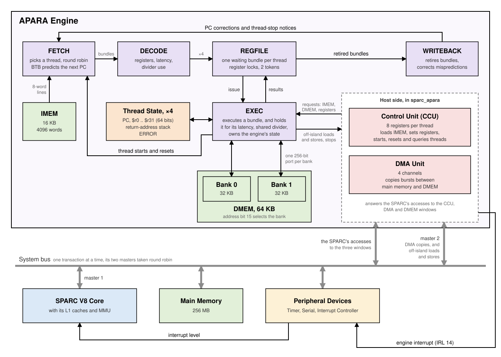

# The APARA Engine

APARA is a compute engine designed to sit next to a SPARC processor
as an accelerator. It is built for vector work on small
integers and low-precision floats (dot products, reductions,
element-wise arithmetic on 4- to 64-bit elements), the kind of
computation that is slow on a general-purpose core but very regular. The
SPARC processor loads the engine's programs, starts its threads, and
moves data in and out of it, while the engine does the number
crunching.

The engine was designed at IIT Bombay (Prof. Madhav Desai). This
project models it in the same two ways as the SPARC core: a fast functional model, and a Sitar
timing model of its pipeline.

---

## The engine at a glance

The block diagram below shows the engine's memories, its pipeline and
thread state, and its host side, which connects it to a SPARC system.
The host side, with its control unit and DMA unit, is present only in
the `sparc_apara` configuration.

- **Bundles**  
    The engine is a VLIW machine. Instead of one instruction at a time,
    it executes *bundles* of up to 8 instructions, which the program has
    grouped to run together.
- **Four hardware threads**  
    Each thread has its own 32 64-bit registers and its own PC, and the
    four share one five-stage pipeline. When one thread waits, for a
    result or a branch, the others keep the pipeline busy.
- **A type in every instruction**  
    A register is just 64 bits. Each instruction says how to read it:
    as one 64-bit integer, as 8 `$i8` elements, as 16 `$f4` floats, and
    so on. One vector instruction thus does up to 16 operations.
- **Local memories**  
    16 KB of instruction memory (IMEM) and 64 KB of data memory (DMEM),
    in two banks, close to the pipeline and fast. In a system, the
    engine reaches main memory too, more slowly, and its DMA unit copies
    data in and out.

---

## In this project

Two configurations model the engine:

- **`apara`**  
    One engine on its own. A program and its data are placed in the
    engine's memories before the run. This is the place to write and
    test engine programs, and to study the engine's timing.
- **`sparc_apara`**  
    A SPARC core (with L1 caches, MMU, and peripheral devices) and one
    engine. The SPARC program loads and runs the engine's programs, and
    both the engine's DMA unit and its own loads and stores reach the
    system's memory.

Both come with functional and timing models, tests, and tools.

## Where to start

- **To write and run engine programs**, read the [Instruction
  Set](isa.md), then [Assembly Language and
  Tools](assembly_and_tools.md), then [Writing and Running
  Programs](running.md).
- **To write engine programs in C**, such as linear algebra kernels,
  read [The C Compiler](compiler.md).
- **To use the engine from a SPARC program**, read [The Engine in a
  System](system.md) for the hardware, then [Programming the
  System](system_programming.md), which walks through an example and
  builds a new program step by step.
- **To run the engine's tests, or add one**, read [APARA Validation
  Suite](validation.md).
- **To study or change the engine's timing**, read the [Timing
  Model](timing_model.md).
- **For the model's sources, where it deliberately departs from them,
  and the open questions** (mainly for the model's authors), see
  [Deviations and Findings](deviations.md).

---

## The code

| Where | What |
|---|---|
| [`model/cpp_common_code/apara/`](https://github.com/sitar-sim/SparcV8_core/tree/main/model/cpp_common_code/apara/) | The engine in plain C++, shared by both models: its state and execution (`AparaCore`), instruction decoding and arithmetic, the file formats and command line, and, for `sparc_apara`, the control unit, the DMA unit, and the three joined together for the cpp_model. Also the timing model's latency table and pipeline helpers (`AparaTiming.h`). |
| [`model/sitar_component_models/Apara*.sitar`](https://github.com/sitar-sim/SparcV8_core/tree/main/model/sitar_component_models/) | The timing model: `AparaEngine` and its five stage modules, and `AparaHost`, the engine's host side in `sparc_apara`. |
| [`model/sitar_component_models/SystemInterconnect.sitar`](https://github.com/sitar-sim/SparcV8_core/blob/main/model/sitar_component_models/SystemInterconnect.sitar) | `sparc_apara`'s two-master bus. |
| [`model/system_models/apara/`](https://github.com/sitar-sim/SparcV8_core/tree/main/model/system_models/apara/), [`model/system_models/sparc_apara/`](https://github.com/sitar-sim/SparcV8_core/tree/main/model/system_models/sparc_apara/) | The two configurations, each with its `cpp_model/` and `sitar_model/`. |
| [`compiler/apara/`](https://github.com/sitar-sim/SparcV8_core/tree/main/compiler/apara/) | The assembler, the disassembler, the C compiler (`apcc.py`, with `include/apara.h`), the program-to-C-header tool, and vim syntax highlighting. |
| [`compiler/include/apara_access_routines.h`](https://github.com/sitar-sim/SparcV8_core/blob/main/compiler/include/apara_access_routines.h) | The SPARC-side C routines. |
| [`validation/apara/`](https://github.com/sitar-sim/SparcV8_core/tree/main/validation/apara/) | The engine's own test suites, and their runner (see [APARA Validation Suite](validation.md#the-engine-suites-validationapara)). |
| [`validation/sparc_apara/`](https://github.com/sitar-sim/SparcV8_core/tree/main/validation/sparc_apara/) | The tests of the SPARC using the engine (see [APARA Validation Suite](validation.md#the-system-suites-validationsparc_apara)). |
