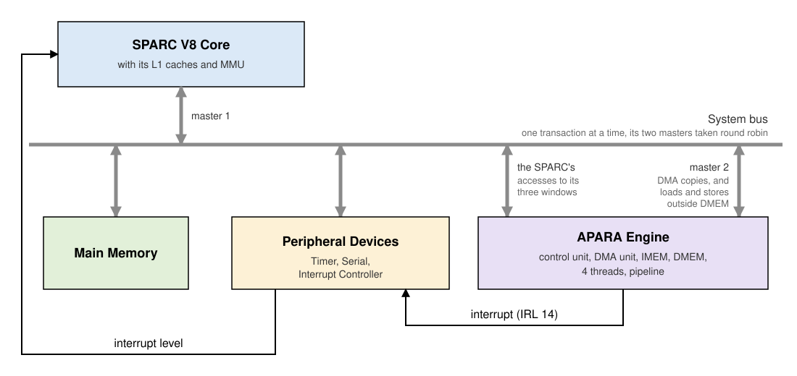
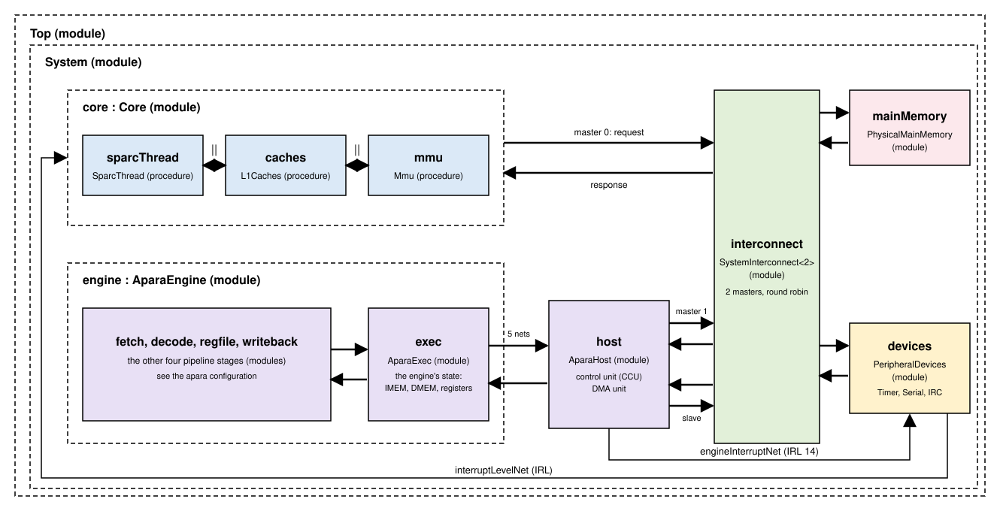

# The APARA Engine in a System (sparc_apara)

The `sparc_apara` configuration puts one APARA engine next to the SPARC
core of `core_l1cache_mmu_devices` (with its L1 caches, MMU, and
peripheral devices). A SPARC program uses the engine as an accelerator:

1. It **loads the engine's program** into the engine's instruction
   memory (IMEM).
2. It **moves the input data** into the engine's data memory (DMEM),
   either by writing it directly or by asking the engine's DMA unit to
   copy it from main memory.
3. It **starts one or more engine threads**, and sets their registers
   first if they need arguments.
4. It **learns when the threads have stopped**, by polling or by an
   interrupt, and how (a `$halt`, or an exception).
5. It **moves the results back**, the same two ways.

All of this goes through memory-mapped registers: the engine's
**control unit** (CCU), which carries out commands for each thread, and
its **DMA unit**, which copies data between main memory and DMEM. The
engine can also read and write main memory itself, with its ordinary
loads and stores.

This page describes the system's parts and how they are connected,
then the SPARC program's side: an example, the setup protocol step by
step, the C routines, and the address map and registers they use. It
ends with how the two models implement it, and the tests.

---

## How the parts are connected

The SPARC core reaches main memory, the devices and the engine through
the system bus. The engine is the bus's second master: its DMA unit, and
its own loads and stores outside DMEM, reach main memory through it too.



The SPARC and the engine communicate in four ways:

- **Commands**, from the SPARC: writes to the control unit's registers
  load IMEM, set a thread's registers, start, reset or query a thread
  (see [The control unit](#the-control-unit)). Writes to the DMA unit's
  registers start copies (see [The DMA unit](#the-dma-unit)).
- **Data in DMEM**, which the SPARC reads and writes directly, through
  its window in the system's address space, or has the DMA unit copy.
- **Data in main memory**, which the engine's own loads and stores, and
  its DMA unit, reach over the bus as its second master.
- **Completion**, from the engine: a thread that stops (with `$halt`, or
  an exception) leaves a completion word for the SPARC to poll, and the
  control unit can raise an interrupt, which reaches the SPARC as IRL 14
  through the Interrupt Controller. A DMA channel that finishes can do
  the same.

The engine's threads share its IMEM, DMEM and pipeline. Each has its own
32 registers, PC, return-address stack, and ERROR register.

In the timing model, these parts are modules joined by nets (see [The
models](#the-models)):



---

## An offload, step by step

The test `validation/sparc_apara/basic/dma_dot_product/` offloads a dot product of
two 32-element `int8_t` vectors to the engine. The engine's program,
`kernel.mcode`, loads both vectors from DMEM, computes four 8-element
dot products in one bundle, adds them up, and stores the 64-bit result
back in DMEM:

```mcode
// The dot product of two 32-element $i8 vectors in DMEM (at $r9 and
// $r10), stored as a 64-bit word at $r9 + 504. ($r9: DMEM's window
// address.)
start:
    ||
        $ld ($i64) $r1 [$r9 + 0]   $ld ($i64) $r2 [$r9 + 8]
        $ld ($i64) $r3 [$r9 + 16]  $ld ($i64) $r4 [$r9 + 24]
    ;
    ||
        $ld ($i64) $r5 [$r10 + 0]   $ld ($i64) $r6 [$r10 + 8]
        $ld ($i64) $r7 [$r10 + 16]  $ld ($i64) $r8 [$r10 + 24]
    ;
    ||
        $dot $r20 ($vi8) $r1 $r5   $dot $r21 ($vi8) $r2 $r6
        $dot $r22 ($vi8) $r3 $r7   $dot $r23 ($vi8) $r4 $r8
    ;
    || + $r24 ($i64) $r20 $r21   + $r25 ($i64) $r22 $r23 ;
    || + $r26 ($i64) $r24 $r25 ;
    || $st ($i64) [$r9 + 504] $r26 ;
    || $halt ;
```

The SPARC program's side, from `dma_dot_product.c`:

```c
#include "kernel.mcode.h"   // kernel_program[], KERNEL_PROGRAM_WORDS, KERNEL_START

apara_load_program(kernel_program, KERNEL_PROGRAM_WORDS);             // 1. the program
apara_dma_start(0, APARA_DMA_LOAD, (uint32_t) a, 0, 1, 0, N, 0);      // 2. a -> DMEM 0
apara_dma_start(1, APARA_DMA_LOAD, (uint32_t) b, 256, 1, 0, N, 0);    //    b -> DMEM 256
apara_dma_wait(0);
apara_dma_wait(1);
apara_write_thread_register(0, 9, APARA_DMEM_BASE);                  // 3. arguments,
apara_write_thread_register(0, 10, APARA_DMEM_BASE + 256);
apara_start_thread(0, KERNEL_START);                                  //    and start
apara_wait_thread(0);                                                 // 4. wait
apara_dma_store(2, (uint32_t) result, 504, 8);                       // 5. DMEM 504 -> result
```

Two DMA channels copy the two vectors at the same time. The engine's
thread 0 gets the two vectors' DMEM addresses in `$r9` and `$r10`, and
runs from the label `start`. The SPARC program then waits for the
thread to stop, and copies the result back to main memory with a third
DMA channel.

---

## Setting up and running the engine

This is the protocol a SPARC program follows to use the engine, with
what is allowed at each step. Each step has a test in
`validation/sparc_apara/`, named in brackets.

### At power-up

No engine thread runs, and IMEM, DMEM and every register of every thread
are zero (`setup/cold_state`). The engine's cycle counter runs from
power-up. Nothing needs initializing before the first command.

### The steps

1. **Load the program** into IMEM, a word at a time, through the
   control unit: `apara_load_program(words, n)`. IMEM is shared by the
   four threads, so one program image serves all of them, and each
   thread starts at its own label. `apara_read_imem` reads a word back
   (`setup/load_verify` checks a whole image).
2. **Put the input data in DMEM**, one of two ways:
    - directly, through the DMEM window, a 32-bit word at a time
      (`apara_dmem_write_word`). Simple, but each word is a bus access
      by the SPARC.
    - by DMA, which copies from main memory while the SPARC goes on with
      other work: `apara_dma_load` copies and waits, `apara_dma_start`
      and `apara_dma_wait` let the SPARC overlap several copies, or do
      its own work meanwhile. A copy can also gather strided data.

    An engine program compiled from C may also need its initialized
    globals: `apara_load_dmem_image` (see [Carrying the engine's
    program](#carrying-the-engines-program)).
3. **Set each thread's registers**, its arguments
   (`apara_write_thread_register`), and **start it** at an IMEM address
   (`apara_start_thread`). Threads may be started one after another, or
   at different times (`threads/staggered`).
4. **Learn that the thread has stopped**, by polling or by an interrupt
   (see [below](#polling-or-an-interrupt)). The completion word says
   how: `APARA_COMPLETION_VALID | APARA_ERROR_HALT` for a thread that
   ended with `$halt`. After an exception it has `APARA_ERROR_EXCEPTION`
   and each slot's exception code (`APARA_ERROR_CODE(word, slot)`), and
   `apara_thread_stop_pc` gives the bundle that failed.
5. **Collect the results** from DMEM, directly (`apara_dmem_read_word`,
   `apara_dmem_read_dword`) or by DMA (`apara_dma_store`, to main
   memory).
6. **Start again**, for the next piece of work: a thread that stopped
   with `$halt` can be started again at once, with new registers. A
   thread stopped by an exception must be reset first
   (`apara_reset_thread`), which clears its PC, return-address stack
   and ERROR, and keeps its registers (`interference/fault_isolation`).
   A new program may be loaded over the old one between runs
   (`setup/reload_program`).

`setup/offload_poll` and `setup/offload_interrupt` do all six steps for
an engine program compiled from C.

### Polling or an interrupt

- **Polling.** `apara_poll_thread(t)` returns 0 while the thread runs,
  and its completion word once it has stopped. `apara_wait_thread(t)`
  polls until then. Each poll is a control-unit command, several bus
  accesses, so a SPARC that only waits is simplest this way.
- **An interrupt.** `apara_request_completion_interrupt(t)` asks the
  control unit to raise the engine's interrupt when thread `t` stops.
  The SPARC goes on with its own work. Its handler reads the completion
  word (`apara_thread_completion`), and clears the interrupt
  (`apara_clear_interrupt`). See [Interrupts](#interrupts) for the
  set-up.

Either way, **each stop is reported exactly once**: after a poll has
returned a thread's stop, the next poll returns 0 until the thread has
been started and has stopped again (`threads/staggered`). A program that
polls several threads can therefore poll them in any order, and never
counts one stop twice.

### What may happen while threads run

- **Each thread on its own data.** Threads do not disturb one another
  as long as each writes only its own part of DMEM
  (`interference/disjoint_regions`). One thread's exception stops only
  that thread (`interference/fault_isolation`).
- **The SPARC and the DMA unit** may read and write other parts of DMEM
  while threads run, and may watch a running thread's progress word
  (`interference/host_while_running`, `interference/dma_while_running`).
- **Not while running**: loading IMEM, or writing a running thread's
  registers. The control unit carries such commands out, but when they
  take effect in the running thread is undefined. Wait for the thread
  to stop first, or stop it with `apara_reset_thread`.

### Threads sharing data

The engine's instruction set has no atomic read-modify-write. Threads
that update the same DMEM word with a load, an add and a store race:
another thread's update can fall between one thread's load and its
store, and is lost (`interference/shared_counter`, where four threads
each add 1, 1000 times, to one word, and the word ends below 4000).
Threads should therefore work on their own data, and leave the SPARC
to combine their results, as `linalg/dot_threads` does with four partial
dot products.

### The SPARC's data cache

The engine's windows are never cached, and the routines reach them with
MMU-bypass accesses. Main memory may be cached, though (in the pages the
MMU marks cacheable), and the caches do not see the engine's writes.
After the DMA unit, or an engine program, writes main memory, the SPARC
reads that data straight from memory, with an MMU-bypass load (the
tests' `physical_word`), or flushes its data cache first (see [Model
Components](../model_components.md#caches)).

### Floating point on the SPARC side

The SPARC's startup code (`compiler/crt0.s`) leaves the FPU off. A SPARC
program that computes with floats, to check an engine's float results
for example, turns it on first, by setting the PSR's EF bit
(`linalg/saxpy`).

---

## Software

### The routines

`compiler/include/apara_access_routines.h` has C routines for all of
the steps above, in the same style as the device routines of
`ajit_access_routines.h` (see [C
Programs](../writing_and_running_c_programs.md)).
Every routine uses MMU-bypass accesses, so it works whether or not the
MMU is enabled, and never goes through the caches.

| Routine | Does |
|---|---|
| `apara_load_program(words, n)` | Write words 0 to n-1 of IMEM. |
| `apara_write_imem(i, w)`, `apara_read_imem(i)` | One IMEM word. |
| `apara_write_thread_register(t, r, v)`, `apara_read_thread_register(t, r)` | A thread's 64-bit register. |
| `apara_start_thread(t, pc)` | Start thread `t` at `pc` (a label's address, from the program's header). |
| `apara_reset_thread(t)` | Stop thread `t`, and clear its PC, return-address stack, and ERROR. Its registers are kept. |
| `apara_poll_thread(t)` | The thread's completion word: 0 while it is running, or valid plus its ERROR once it has stopped. Each stop is reported once. |
| `apara_wait_thread(t)` | Poll until the thread stops, and return its completion word. |
| `apara_thread_stop_pc(t)` | Where the thread stopped. |
| `apara_request_completion_interrupt(t)`, `apara_thread_completion(t)`, `apara_clear_interrupt(t)` | Learn of the stop by interrupt instead, see [Interrupts](#interrupts). |
| `apara_dma_start(c, op, src, dst, bursts, gap, bytes_per_burst, irq)` | Start DMA channel `c`, see [The DMA unit](#the-dma-unit). |
| `apara_dma_done(c)`, `apara_dma_wait(c)` | Whether channel `c` has finished, and waiting for it. |
| `apara_dma_load(c, dmem, src, n)`, `apara_dma_store(c, dst, dmem, n)` | One contiguous copy of `n` bytes into or out of DMEM, waiting for it. |
| `apara_dma_clear_interrupt(c)` | Clear channel `c`'s interrupt. |
| `apara_dmem_write_word(o, v)`, `apara_dmem_read_word(o)` | A 32-bit word of DMEM, at byte offset `o`, directly. |
| `apara_dmem_read_dword(o)` | A 64-bit word of DMEM (the high half at the lower address). |
| `apara_load_dmem_image(pairs, n)` | Write a C engine program's initialized globals into DMEM (see [below](#carrying-the-engines-program)). |
| `apara_read_timer()` | The engine's cycle counter. |

The completion word's bits have names: `APARA_COMPLETION_VALID`,
`APARA_ERROR_HALT`, `APARA_ERROR_EXCEPTION`, `APARA_ERROR_RAS`, and
`APARA_ERROR_CODE(word, slot)` for a slot's exception code. A thread
that ended with `$halt` reports `APARA_COMPLETION_VALID |
APARA_ERROR_HALT`.

### Carrying the engine's program

An engine program travels inside the SPARC program as a C array.
`compiler/apara/apara_obj_to_c.py` assembles it and writes a header:

```bash
python3 compiler/apara/apara_obj_to_c.py kernel.mcode       # writes kernel.mcode.h
```

```c
static const uint32_t kernel_program[] = { ... };   // IMEM words 0, 1, ...
#define KERNEL_PROGRAM_WORDS 33
#define KERNEL_START 0x0                             // each label's address
```

The names come from the file name (`--name` chooses another).

An engine program written in C (see [The C Compiler](compiler.md)) is
handled the same way: `apara_obj_to_c.py kernel.c` compiles it for the
system, with DMEM at its window address, and writes `kernel.c.h`. That
header also gives each global variable's DMEM byte offset, and the DMEM
words its initializers set:

```c
#define KERNEL_DMEM_DATA 0x0                              // each global's DMEM offset
static const uint32_t kernel_dmem_image[] = { ... };     // (offset, value) pairs
#define KERNEL_DMEM_IMAGE_WORDS 6
```

The SPARC program then loads the program and the initial data, puts its
input at the globals' offsets, and reads the results from them:

```c
apara_load_program(kernel_program, KERNEL_PROGRAM_WORDS);
apara_load_dmem_image(kernel_dmem_image, KERNEL_DMEM_IMAGE_WORDS);
apara_dma_load(0, KERNEL_DMEM_DATA, (uint32_t) data, sizeof(data));
```

An `__entry` function's parameters arrive in `$r1`, `$r2`, ..., set with
`apara_write_thread_register` before the thread starts. The image holds
only the non-zero words: DMEM keeps whatever an earlier program left, so
globals that must start at zero are cleared by the SPARC program, unless
this is the first program since power-up.

A test in the validation suite names its engine programs in its
`.vprj`, with an `MCODE = kernel.mcode` (or `kernel.c`) line, and
`validation/build_hex.py` writes the headers before compiling (see
[Validation Suite](../validation_suite.md#the-vprj-expected-results-format)).

---

## Address map

The system's physical addresses:

| Range | What |
|---|---|
| `0x0000_0000` .. | Main memory (256 MB), except: |
| `0x0100_0000` .. `0x0100_FFFF` | The engine's DMEM, 64 KB. |
| `0xFFFE_0000` .. `0xFFFE_007F` | The engine's control unit (CCU) registers. |
| `0xFFFE_2000` .. `0xFFFE_207F` | The engine's DMA registers. |
| `0xFFFF_0000` .. `0xFFFF_FFFF` | The peripheral devices. |

Only main memory is ever cached, the engine's windows never are. A SPARC
program should reach them with MMU-bypass accesses (ASI `0x20`), as the
routines above do. A program's own code and data must stay clear of the
DMEM window, which lies inside main memory's range.

### The engine's own view

Inside the engine, an address in its own DMEM window is local, and
every other address goes **off island**, out to the system, as in the
hardware. So in a system, an engine program addresses its DMEM by the
window's address. Usually the SPARC program passes that address in a
register, as `dma_dot_product` does in `$r9`:

```mcode
// $r9 = 0x01000000 (set by the SPARC): DMEM byte 0x100 is $r9 + 256.
    || $st ($i64) [$r9 + 256] $r3 ;
```

An engine load or store to any other address reaches main memory (or a
device) through the system bus, which takes much longer than a DMEM
access. The standalone `apara` configuration instead aliases every
address into DMEM.

---

## The control unit

The control unit has a block of 8 32-bit registers for each of the
engine's four threads, at `0xFFFE_0000 + 32*thread + 4*register`.
Commands for a thread go through its block.

| Register | Contents |
|---|---|
| R0 | Control: [31:16] sequence number, [15:14] a thread number (for command 9), [11:8] the command, and the flags [4] run the command interpreter, [3] interrupt enable, [2] completed, [1] started, [0] start. (Bits [7:5], "init done" and "cpu mode" in the hardware, are kept but have no effect in the model.) |
| R1 | PC |
| R2 | IMEM index, or register number |
| R3 | IMEM write data, or timer high |
| R4 | IMEM read data, or timer low |
| R5 | Completion: [31] valid, [26] RAS error, [25] halt, [24] exception, [23:0] exception codes |
| R6 | Register high, or stop PC, or RAS depth |
| R7 | Register low, or next PC, or RAS top |

To give a command, the host writes its arguments into R1 to R7, then
writes R0 with the command and the flags *start* and *run the command
interpreter*. The unit sets *started*, carries the command out, writes
its results into the registers, and sets *completed*. The host polls
R0 for *completed* before reading the results or giving the next
command.

| Command | Does |
|---|---|
| 1 read IMEM | R4 := IMEM[R2] |
| 2 write IMEM | IMEM[R2] := R3. IMEM is shared by the threads, so any thread's block will do. |
| 3 reset | Stop the thread: PC 0, RAS and ERROR cleared, registers kept. |
| 4 run | Start the thread at R1. |
| 5 read register | R6:R7 := register R2 (high:low) |
| 6 write register | register R2 := R6:R7 |
| 7 completion | Once the thread has stopped: R5 := valid plus its ERROR, and R6 := its PC (each stop is reported once). Before that, R5 := 0. With *interrupt enable* set, the command instead waits for the stop, and then raises the engine interrupt. |
| 8 step | Run one bundle at R1, with local data only. R7 := the next PC. |
| 9 RAS state | R6 := depth, R7 := top of the RAS of the thread named in R0[15:14]. |
| 10 timer | R3:R4 := the engine's cycle count. |

Writing R0 with *interrupt enable* clear clears the interrupt.

---

## The DMA unit

The DMA unit copies data between main memory and DMEM, while the SPARC
and the engine both go on working. It has four independent channels,
each with 8 registers at `0xFFFE_2000 + 32*channel + 4*register`:

| Register | Contents |
|---|---|
| R0 | Control: [31:24] operation (1 load: main memory to DMEM, 2 store: DMEM to main memory), [23:20] and [19:16] the top 4 bits of the 36-bit source and destination addresses, [15:8] sequence number, and the flags [4] error, [3] interrupt enable, [2] completed, [1] started, [0] scheduled. |
| R1, R2 | Source and destination base addresses. |
| R3 | Total bytes (for the record only). |
| R4 | Number of bursts. |
| R5 | Gap: the distance between bursts. |
| R6 | Bytes per burst. Once completed: the stop cycle. |
| R7 | The start cycle. |

The host writes R1 to R6, then writes R0 with the operation and
*scheduled*, which starts the channel. A copy is a number of **bursts**,
so one command can also collect or spread out strided data:

- A **load gathers**: burst *i* comes from source + *i*·gap, and lands
  at destination + *i*·(bytes per burst), so the bursts end up packed
  together in DMEM.
- A **store scatters**, the reverse: packed in DMEM, spread out in main
  memory.

For one contiguous copy, use a single burst. The DMEM-side address may
be a DMEM byte offset or a window address. When the copy is done, the
channel sets *completed*, and raises the engine interrupt if *interrupt
enable* was set. Writing R0 with *interrupt enable* clear clears it. An
unknown operation completes at once, with *error* set.

---

## Interrupts

Both units can interrupt the SPARC when something finishes: the
control unit when a thread stops (command 7 with *interrupt enable*),
and the DMA unit when a channel completes. Either one drives the
Interrupt Controller's external input, IRL 14 (`EXTERNAL_IRL`).

A program that takes interrupts links the interrupt startup code (a
`STARTUP = crt0_interrupts.s` line in its `.vprj`), and registers a
handler with the dispatch routines of `compiler/include/ajit_mt_irc.h`
(see [Taking interrupts](../writing_and_running_c_programs.md#taking-interrupts)).
From `validation/sparc_apara/basic/run_interrupt/`:

```c
void engine_handler(void)
{
    completion = apara_thread_completion(0);   // the stop, as apara_poll_thread() would report it
    apara_clear_interrupt(0);                  // clear the source
}

int main(void)
{
    ajit_initialize_interrupt_handlers_to_null();
    ajit_set_interrupt_handler(EXTERNAL_IRL, engine_handler);
    writeInterruptControlRegister(0, 0, (1u << EXTERNAL_IRL) | 1u);   // slot 0: enable, IRL 14

    apara_load_program(kernel_program, KERNEL_PROGRAM_WORDS);
    apara_start_thread(0, KERNEL_LOOP);
    apara_request_completion_interrupt(0);
    ...                                        // the SPARC goes on with its own work
}
```

---

## The models

Both models carry out the same commands with the same C++ classes:
`AparaControlCore` (the control unit), `AparaDmaCore` (the DMA unit),
and the engine itself, `AparaCore`. They differ, as in every
configuration, in timing.

- **cpp_model**  
    The bus routes the engine's three windows to the engine, and the
    engine's off-island accesses and DMA transfers go back through the
    same bus. After every SPARC instruction, the engine runs one bundle,
    and the DMA unit moves one piece of a copy (up to 8 bytes).
- **sitar_model**  
    The engine's pipeline (`AparaEngine`, see [APARA Timing
    Model](timing_model.md)) and its host side (`AparaHost`: the control
    and DMA units) are modules beside the core. The bus becomes an
    interconnect with two masters, the core and the host side, taken
    round robin. See [Modules and nets](#modules-and-nets) below.

In the sitar_model, the parts divide the work like this:

| Module | Owns, does |
|---|---|
| `engine.exec` | The engine's state. Serves the host side's requests (DMEM, registers, IMEM, thread commands), one per cycle. Sends a bundle's off-island loads and stores to the host side, and holds the bundle until they are answered. Tells the host side when a thread stops. |
| `host` | The control unit's and DMA unit's registers and commands. Answers the SPARC's accesses to the engine's three windows, and sends DMA transfers and off-island accesses onto the bus. |
| `interconnect` | One transaction at a time, from the core or from the host side, to main memory, the devices, or the host side. |

Every net crossing takes a cycle, so a SPARC access to a control-unit
register crosses four nets (core to interconnect to host, and back),
and one to DMEM six, since it also goes on to `engine.exec`, which owns
DMEM.

### Modules and nets

`System` is that of `core_l1cache_mmu_devices`, with `engine` (the same
`AparaEngine` module as in the `apara` configuration, see [APARA Timing
Model](timing_model.md#modules-and-nets)) and `host` added, and its
bridge replaced by the two-master interconnect. The interconnect routes
the SPARC's accesses to the engine's three windows to `host`, and
carries `host`'s DMA transfers and off-island accesses as its second
master.

`host` reaches the engine's state in `exec` over five more nets: one
pair for its requests to the engine (read a register, write IMEM, start
a thread, ...), one pair for the engine's loads and stores that leave
it, and one for the notice that a thread has stopped. The engine's
interrupt goes from `host` to the Interrupt Controller's external
input, IRL 14.

<pre>
<a href="https://github.com/sitar-sim/SparcV8_core/blob/main/model/system_models/sparc_apara/sitar_model/src/Top.sitar">Top</a>
 |
 +-- <a href="https://github.com/sitar-sim/SparcV8_core/blob/main/model/system_models/sparc_apara/sitar_model/src/System.sitar">System</a> (module)
      |
      +-- core : <a href="https://github.com/sitar-sim/SparcV8_core/blob/main/model/system_models/sparc_apara/sitar_model/src/Core.sitar">Core</a> (module)
      |    |
      |    +-- sparcThread : <a href="https://github.com/sitar-sim/SparcV8_core/blob/main/model/sitar_component_models/SparcThread.sitar">SparcThread</a> (procedure)
      |    |
      |    +-- caches : <a href="https://github.com/sitar-sim/SparcV8_core/blob/main/model/sitar_component_models/L1Caches.sitar">L1Caches</a> (procedure)
      |    |
      |    +-- mmu : <a href="https://github.com/sitar-sim/SparcV8_core/blob/main/model/sitar_component_models/Mmu.sitar">Mmu</a> (procedure)
      |
      +-- interconnect : <a href="https://github.com/sitar-sim/SparcV8_core/blob/main/model/sitar_component_models/SystemInterconnect.sitar">SystemInterconnect</a>&lt;2&gt; (module)
      |
      +-- mainMemory : <a href="https://github.com/sitar-sim/SparcV8_core/blob/main/model/sitar_component_models/PhysicalMainMemory.sitar">PhysicalMainMemory</a> (module)
      |
      +-- devices : <a href="https://github.com/sitar-sim/SparcV8_core/blob/main/model/sitar_component_models/PeripheralDevices.sitar">PeripheralDevices</a> (module)
      |
      +-- engine : <a href="https://github.com/sitar-sim/SparcV8_core/blob/main/model/sitar_component_models/AparaEngine.sitar">AparaEngine</a> (module: fetch, decode, regfile, exec, writeback, as in apara)
      |
      +-- host : <a href="https://github.com/sitar-sim/SparcV8_core/blob/main/model/sitar_component_models/AparaHost.sitar">AparaHost</a> (module)

core.requestOut                   --coreRequestNet-->       interconnect.masterRequestIn[0]
core.responseIn                   <-coreResponseNet--       interconnect.masterResponseOut[0]
host.masterRequestOut             --hostRequestNet-->       interconnect.masterRequestIn[1]
host.masterResponseIn             <-hostResponseNet--       interconnect.masterResponseOut[1]
interconnect.memoryRequestOut     --memoryRequestNet-->     mainMemory.requestIn
interconnect.memoryResponseIn     <-memoryResponseNet--     mainMemory.responseOut
interconnect.devicesRequestOut    --devicesRequestNet-->    devices.requestIn
interconnect.devicesResponseIn    <-devicesResponseNet--    devices.responseOut
interconnect.engineRequestOut     --engineRequestNet-->     host.slaveRequestIn
interconnect.engineResponseIn     <-engineResponseNet--     host.slaveResponseOut
devices.interruptLevelOut         --interruptLevelNet-->    core.interruptLevelIn
host.interruptOut                 --engineInterruptNet-->   devices.externalInterruptIn
host.serviceOut                   --serviceRequestNet-->    engine.exec.serviceIn
host.serviceIn                    <-serviceResponseNet--    engine.exec.serviceOut
engine.exec.offIslandOut          --offIslandRequestNet-->  host.offIslandIn
engine.exec.offIslandIn           <-offIslandResponseNet--  host.offIslandOut
engine.exec.stopOut               --stopNet-->              host.stopIn
</pre>

---

## Tests

`validation/sparc_apara/` holds the tests of the SPARC using the engine.
Each is a bare-metal SPARC C program, with one or more engine programs,
built and run like the other C tests (see [Validation
Suite](../validation_suite.md)), on `--config sparc_apara`. On the
sitar_model, give them a larger cycle limit:

```bash
python3 validation/run_tests.py validation/sparc_apara --config sparc_apara
python3 validation/run_tests.py validation/sparc_apara --config sparc_apara --sitar --max-cycles 50000000
```

Every test reports like the device tests: `%o0` = 1 if every check
passed, and `%o1` has one bit per check, listed in the test's header
comment. The SPARC program computes the expected results itself.

| Folder | Tests | What they check |
|---|---|---|
| `basic/` | 8 | Each part of the engine's interface on its own: IMEM and registers, running and polling, the completion interrupt, exceptions, four threads, the engine's own main-memory accesses, DMA and its interrupt, and a whole offload by DMA (`dma_dot_product`). |
| `setup/` | 5 | Bringing the engine up, one thread: its state at power-up, loading and reading back its memories, complete offloads of a program compiled from C (by polling and by interrupt), and loading a second program over the first. |
| `threads/` | 5 | The same program on 1, 2, 3 and 4 threads, each on its own slice of the data, and threads started and restarted at different times. |
| `interference/` | 5 | Whether threads, the SPARC and the DMA unit disturb one another (see [What may happen while threads run](#what-may-happen-while-threads-run)), and the one real interference, a race on shared data. |
| `linalg/` | 3 | Linear algebra offloaded to the engine: an 8x8 matrix product on four threads, SAXPY in floating point, and a four-thread dot product compiled from C. |

Each folder has a `README.md` describing its tests, and
`validation/sparc_apara/README.md` summarizes the protocol above.
