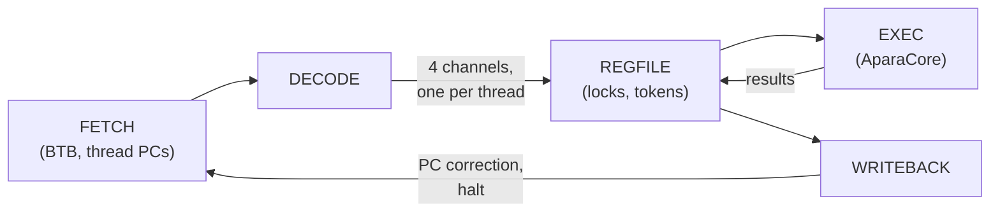

# APARA Timing Model

The sitar_model of the `apara` configuration is a cycle-level model of
the engine's pipeline, built from the APARA microarchitecture document
(*APARA Engine: Microarchitecture and Timing*, in the APARA repository's
`engine_isp/docs/microarch`). As everywhere in this project, the
functionality comes from the same C++ class the fast model uses
(`AparaCore`), and the timing from the Sitar structure itself: the
pipeline's stages are modules, its channels are nets, and a bundle's time
is spent waiting in them, never computed after the fact.

## Structure



`AparaEngine` (`model/sitar_component_models/AparaEngine.sitar`) holds
five modules, one per stage, joined by nets with the hardware's channel
depths (2 entries, 1 for EXEC's results and WRITEBACK's notices). Each
module pulls its inputs in phase 0 of a cycle and pushes its outputs in
phase 1, so a bundle takes at least one cycle per stage, and a stage
whose output channel is full holds its bundle: the hardware's elastic
pipeline.

| Stage | Module | What it does in a cycle |
|---|---|---|
| FETCH | `AparaFetch` | picks a running thread (round robin), reads the 8-word IMEM line holding its PC, and sends the line's bundles one per cycle, in PC order, before picking another thread; predicts each bundle's next PC with the BTB |
| DECODE | `AparaDecode` | decodes a bundle: registers read and written, latency, divider use; sends it on its thread's channel |
| REGFILE | `AparaRegfile` | holds one bundle per thread; issues one per cycle (round robin) whose registers are all unlocked, if a token is free; locks the registers it writes. Releases a bundle's locks and token when its result comes back from EXEC |
| EXEC | `AparaExec` | runs the bundle (`AparaCore::step()`) and holds it for its latency; skips wrong-path bundles |
| WRITEBACK | `AparaWriteback` | sends FETCH a PC correction for a mispredicted bundle, a halt notice for a stopped thread |

A bundle with no stalls is fetched in cycle *c*, decoded in *c+1*, issued
in *c+2*, runs in EXEC from *c+3*, comes back to REGFILE after its latency
and leaves WRITEBACK a cycle later: a one-bundle program takes 6 cycles.

## Timing rules

**Latency.** A bundle's time in EXEC is its slowest instruction's latency,
from a table loaded at start-up (below), or its memory phase if that is
longer. The defaults are the microarchitecture document's table:

| Entry | Cycles | Covers |
|---|---|---|
| `nop any`, `control any`, `halt any`, `misc any`, `logic any` | 1 | `$null`, branches/calls/returns, `$halt`, `$set $slice $pack`, <code>&#124; &amp; ^ ~&#124; ~&amp; ~^</code> |
| `arith int<=32`, `arith fp<=16` | 1 | `+ - *` scalar and vector |
| `arith int64` | 2 | |
| `arith fp32`, `arith fp64` | 3 | |
| `shift int<=32` / `shift int64` | 1 / 2 | `<< >>` |
| `dot int<=32`, `dot fp<=16` / `dot int64`, `dot fp32`, `dot fp64` | 2 / 3 | |
| `cast narrow` / `cast wide` | 1 / 2 | narrow: integer to integer, float to integer, floats up to f16 |
| `vreduce any` | 2 | *assumed*: not in the hardware's table |
| `cmov any` | 1 | *assumed*: not in the hardware's table |
| `memory local` | 3 | a bundle's DMEM accesses |
| `divide any`, `sqrt any` | 10 | the designer's figure, to be confirmed |

`--latency-file <file>` overrides entries, one `<class> <operands>
<cycles>` per line (`#` comments):

```text
arith fp32 5     # an f32 add/subtract/multiply takes 5 cycles
divide any 20
```

**Memory.** DMEM has two banks (address bit 15), each with one 256-bit
port. A bundle's accesses to different banks proceed in parallel;
accesses to the same bank one after another, each extra one adding
`bankConflictCycles` (1).

**Divider.** `/` and `$fsqrt` share one unit: a bundle that needs it
waits in EXEC until the previous user has finished.

**EXEC.** By default EXEC takes a new bundle every cycle (it is internally
pipelined) and results leave it in order, one per cycle.

**Register locks and tokens.** A bundle waits in REGFILE while any
register it reads or writes is locked by an earlier bundle of its thread.
At most 2 bundles are in EXEC at a time (REGFILE's tokens); a token comes
back with the bundle's result, two cycles after issue for a 1-cycle
bundle, so the pipeline runs at one bundle per cycle.

**Branch prediction.** The branch target buffer has 256 entries, direct
mapped by the low 8 bits of the bundle's PC and shared by the threads.
Each holds a 22-bit tag, a 2-bit counter (0 strongly taken, 3 strongly not
taken) and a target; a lookup predicts the target if the tag matches and
the counter is below 3, otherwise the next bundle. Only PC corrections
train it: a taken correction lowers the counter and sets the target, a
not-taken one raises it, a new entry starts at 0 or 3.

**Mispredicts.** EXEC compares each bundle's actual next PC with FETCH's
prediction. On a mismatch, the thread's state in EXEC becomes
*mispredicted*: its following bundles, fetched on the wrong path, are
skipped (not executed; their locks are still released) until FETCH,
corrected by WRITEBACK, sends the first bundle of the right path, marked
*new stream*. The penalty is 5 cycles with one thread; other threads keep
the pipeline busy meanwhile. A halting bundle does the same for its
thread, for good.

## Knobs

In `model/system_models/apara/sitar_model/src/Top.sitar`, one place for
all of them (rebuild after a change):

| Knob | Default | Meaning |
|---|---|---|
| `engine.fetch.imemDelay` | 0 | cycles between picking a thread and its IMEM line arriving |
| `engine.exec.pipelined` | true | false: EXEC holds one bundle for its whole latency |
| `engine.exec.latency.bankConflictCycles` | 1 | per extra same-bank access in a bundle |
| `engine.regfile.tokens` | 2 | bundles allowed in EXEC |

`--stats` prints the pipeline's counters: bundles fetched, executed and
skipped, mispredicts, BTB-predicted fetches, cycles lost to register locks,
tokens and the divider, and bank conflicts.

## Validation

`validation/apara/timing/` holds microbenchmarks, each with its cycle count
derived by hand from the rules above and written in its header: one bundle
(6 cycles), a stream at full rate, latency, a read-after-write stall versus
the independent case, the shared divider, a bank conflict versus two banks,
a mispredict, two threads. `run_tests.py --sitar` checks every count
exactly. Each knob was also checked by changing it alone: every count moved
by exactly the derived amount (for example `imemDelay = 1` adds one cycle
per IMEM line, `tokens = 1` halves the issue rate).

The model is checked against the microarchitecture document, not yet
against the hardware (Aa_model) traces: its open items (the latencies
marked above, EXEC's structure, same-bank ordering) are listed in
[Deviations and Findings](deviations.md).
