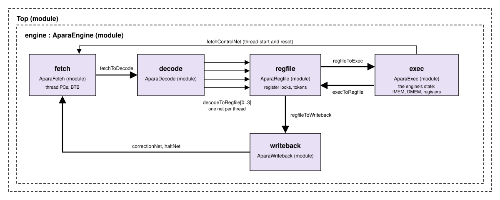

# APARA Timing Model

The sitar_model of the `apara` configuration is a cycle-level model of
the engine's pipeline, following the APARA microarchitecture document,
and is the same pipeline `sparc_apara` uses.

As everywhere in this project, the model keeps function and timing
apart. What each bundle does comes from the same C++ class the fast
functional model runs, so the two models always compute the same
results. The timing comes from the Sitar structure itself: the
pipeline's stages are modules, the channels between them are nets, and
a bundle's time is spent actually waiting in them, for a free channel, a
register, or the divider. It is never computed after the fact. This is
what makes the timing model trustworthy for experiments: change a
channel depth or a latency, and every effect it has on the rest of the
pipeline follows by itself.

---

## The pipeline



The engine's five stages, each a module, are joined by nets with the
hardware's channel depths: 2 entries, except 1 for EXEC's results and
for WRITEBACK's notices to FETCH. Each module takes its inputs in the
first half of a cycle and sends its outputs in the second half, so a
bundle spends at least one cycle in each stage. A stage whose output
channel is full holds its bundle until there is room, and the stages
before it then fill up and wait too. This is the hardware's *elastic*
pipeline.

- **FETCH**  
    Picks a running thread (round robin), reads the 8-word IMEM line
    holding its PC, and sends that line's bundles to DECODE, one per
    cycle and in PC order, before picking another thread. It predicts
    each bundle's next PC with the branch target buffer (BTB).
- **DECODE**  
    Decodes a bundle: which registers it reads and writes, how long it
    will take in EXEC, and whether it needs the divider. It then sends
    the bundle on to REGFILE, on its thread's own channel.
- **REGFILE**  
    Holds one waiting bundle per thread. Each cycle it issues one of them
    (round robin) whose registers are all free, provided a *token* is
    free, and locks the registers that bundle will write. When the
    bundle's result comes back from EXEC, it releases those locks and the
    token.
- **EXEC**  
    Executes the bundle, then holds it for its latency. EXEC owns the
    engine's state: its memories, registers, and threads. It skips
    bundles fetched on a wrong path.
- **WRITEBACK**  
    Retires the bundle. It sends FETCH a PC correction when a bundle's
    next PC was mispredicted, and a notice when a thread has stopped.

### A bundle's journey

A bundle with no stalls is fetched in some cycle *c*, decoded in *c+1*,
issued by REGFILE in *c+2*, and executed in EXEC from *c+3*. Its result
comes back to REGFILE after its latency, and it leaves WRITEBACK one
cycle later. So a program of one 1-cycle bundle takes 6 cycles from
start to finish. Later bundles overlap with it, so a stream of
independent bundles completes at one bundle per cycle.

### Modules and nets

The `apara` configuration's `Top` holds one `AparaEngine` and nothing
else: there is no SPARC core and no system around it. This shows which
design unit instantiates which, and the nets joining the stages.

<pre>
<a href="https://github.com/sitar-sim/SparcV8_core/blob/main/model/system_models/apara/sitar_model/src/Top.sitar">Top</a>
 |
 +-- engine : <a href="https://github.com/sitar-sim/SparcV8_core/blob/main/model/sitar_component_models/AparaEngine.sitar">AparaEngine</a> (module)
      |
      +-- fetch     : <a href="https://github.com/sitar-sim/SparcV8_core/blob/main/model/sitar_component_models/AparaFetch.sitar">AparaFetch</a> (module)
      |
      +-- decode    : <a href="https://github.com/sitar-sim/SparcV8_core/blob/main/model/sitar_component_models/AparaDecode.sitar">AparaDecode</a> (module)
      |
      +-- regfile   : <a href="https://github.com/sitar-sim/SparcV8_core/blob/main/model/sitar_component_models/AparaRegfile.sitar">AparaRegfile</a> (module)
      |
      +-- exec      : <a href="https://github.com/sitar-sim/SparcV8_core/blob/main/model/sitar_component_models/AparaExec.sitar">AparaExec</a> (module)
      |
      +-- writeback : <a href="https://github.com/sitar-sim/SparcV8_core/blob/main/model/sitar_component_models/AparaWriteback.sitar">AparaWriteback</a> (module)

fetch.toDecode          --fetchToDecode-->          decode.fromFetch
decode.toRegfile[0..3]  --decodeToRegfile[0..3]-->  regfile.fromDecode[0..3]
regfile.toExec          --regfileToExec-->          exec.fromRegfile
exec.toRegfile          --execToRegfile-->          regfile.fromExec
regfile.toWriteback     --regfileToWriteback-->     writeback.fromRegfile
writeback.correctionOut --correctionNet-->          fetch.correctionIn
writeback.haltOut       --haltNet-->                fetch.haltIn
exec.fetchControlOut    --fetchControlNet-->        fetch.controlIn
</pre>

`decodeToRegfile` is one net per thread, so REGFILE can hold a waiting
bundle of each thread and issue whichever one is ready.
`fetchControlNet` carries thread starts and resets to FETCH.

---

## Timing rules

### Instruction latency

A bundle's time in EXEC is the latency of its slowest instruction, or
the time of its memory accesses if that is longer. The latencies come
from a table, by instruction class. The defaults:

| Entry | Cycles | Covers |
|---|---|---|
| `nop any`, `control any`, `halt any`, `misc any`, `logic any` | 1 | `$null`, branches/calls/returns, `$halt`, `$set $slice $pack`, <code>&#124; &amp; ^ ~&#124; ~&amp; ~^</code> |
| `arith int<=32`, `arith fp<=16` | 1 | `+ - *`, scalar and vector |
| `arith int64` | 2 | |
| `arith fp32`, `arith fp64` | 3 | |
| `shift int<=32` / `shift int64` | 1 / 2 | `<< >>` |
| `dot int<=32`, `dot fp<=16` / `dot int64`, `dot fp32`, `dot fp64` | 2 / 3 | |
| `cast narrow` / `cast wide` | 1 / 2 | narrow: integer to integer, float to integer, floats up to f16 |
| `vreduce any` | 2 | *assumed*: not in the hardware's table |
| `cmov any` | 1 | *assumed*: not in the hardware's table |
| `memory local` | 3 | a bundle's DMEM accesses |
| `divide any`, `sqrt any` | 10 | the designer's figure, to be confirmed |

To try other latencies, pass `--latency-file <file>` to the `apara`
simulator. Each line of the file overrides one entry, as `<class>
<operands> <cycles>`, and `#` starts a comment:

```text
arith fp32 5     # an f32 add/subtract/multiply takes 5 cycles
divide any 20
```

### Data memory

DMEM has two banks (address bit 15 selects the bank), each with its own
256-bit port. A bundle's accesses to different banks proceed in
parallel. Accesses to the same bank go one after another, each extra
one adding a cycle (the `bankConflictCycles` knob). Placing two arrays
that are read together in different banks avoids the conflict.

### The divider

Integer and float divides and square roots share one divider. A bundle
that needs it waits in EXEC until the previous user has finished.

### EXEC

By default EXEC is internally pipelined: it takes a new bundle every
cycle, and results leave it in order, one per cycle. The `pipelined`
knob selects instead a stage that holds one bundle for its whole
latency.

### Register locks and tokens

A bundle waits in REGFILE while any register it reads or writes is
locked by an earlier bundle of its thread, that is, until the earlier
bundle's result is back. This is how the pipeline keeps a thread's
bundles in order without stalling the other threads.

At most 2 bundles are in EXEC at a time, one per REGFILE *token*. A
token comes back with the bundle's result, two cycles after issue for a
1-cycle bundle, so two tokens are exactly enough to issue one bundle
every cycle.

### Branch prediction

The branch target buffer has 256 entries, direct mapped by the low 8
bits of a bundle's PC, and shared by the four threads. Each entry holds
a 22-bit tag, a 2-bit counter (0 strongly taken, 3 strongly not taken),
and a target. A lookup predicts the entry's target if the tag matches
and the counter is below 3, and otherwise the next bundle.

Only PC corrections train the BTB: a correction to a taken branch lowers
the counter and sets the target, one to a not-taken branch raises the
counter, and a new entry starts at 0 or 3 accordingly.

Calls and returns are predicted the same way, by their BTB entry: a
`$return` is predicted to go where it went last time. Some consequences
for programs, each measured by a test in `validation/apara/predictor/`:

- A loop's closing branch mispredicts once per run of the loop, at its
  exit, once the BTB has learned it.
- A correctly predicted branch never trains its entry. So a loop that
  is entered again and again (an inner loop) pulls its counter up by one
  at each exit, and after three exits the entry predicts "not taken":
  from then on every run of the inner loop mispredicts twice, at its
  first pass and at its exit (`nested_loops`).
- A function called from several places mispredicts its return whenever
  the caller changes (`call_sites`).
- Two branches whose PCs share their low 8 bits share an entry, and
  evict each other (`alias`).

### Mispredicts

EXEC compares each bundle's actual next PC with the one FETCH predicted.
On a mismatch, the thread's following bundles, already fetched on the
wrong path, are skipped (not executed, though their register locks are
still released) until FETCH, corrected by WRITEBACK, sends the first
bundle of the right path. With one thread, a mispredict costs 5 cycles.
With several, the other threads keep the pipeline busy meanwhile. A
thread's halting bundle is handled the same way, except that the thread
then stays stopped.

---

## Knobs

All the timing knobs are set in one place, `Top.sitar` in `apara`
(`model/system_models/apara/sitar_model/src/Top.sitar`) and
`System.sitar` in `sparc_apara`. Rebuild after a change.

| Knob | Default | Meaning |
|---|---|---|
| `engine.fetch.imemDelay` | 0 | Cycles between FETCH picking a thread and its IMEM line arriving. |
| `engine.exec.pipelined` | true | false: EXEC holds one bundle for its whole latency. |
| `engine.exec.latency.bankConflictCycles` | 1 | Cycles per extra same-bank access in a bundle. |
| `engine.regfile.tokens` | 2 | How many bundles may be in EXEC at once. |
| `engine.regfile.interlock` | true | false: REGFILE ignores its register locks, to show which reads would be hazards without them (see [Hazards](running.md#hazards)). Not a hardware option. |

`--stats` prints the pipeline's counters: bundles fetched, executed, and
skipped, mispredicts, fetches that followed a BTB prediction, the cycles
lost to register locks, to tokens, and to the divider, bank
conflicts, and the two hazard checks (see [Performance
Modeling](../performance_modeling.md#apara-engine)).

---

## Validation

The timing model is checked by three suites in `validation/apara/`,
each count derived by hand from the rules above, and written in the
test's header:

- **`timing/`**, microbenchmarks with exact cycle counts: one bundle (6
  cycles), a stream of bundles at full rate, latency, a read-after-write
  stall against the independent case, the shared divider, a bank
  conflict against the same accesses on two banks, a mispredict, and two
  threads sharing the pipeline.
- **`predictor/`**, exact mispredict counts for loops, nested loops,
  aliasing entries, and calls and returns.
- **`hazards/`**, the register interlock (see
  [Hazards](running.md#hazards)).

`run_tests.py --sitar` checks every count exactly. The counts are
derived for the default knob values and latency table, so the suite
checks the timing model at those settings only. Each knob was also
checked by setting it to several values, one at a time: every count
moved by exactly the amount the rules predict. `timing/README.md` has
those counts, and how to set the knobs back to their defaults
afterwards.

The kernels and C programs of the other suites run on the timing model
too, and their `--stats` show where a larger program spends its
cycles. For example, an 8x8 matrix product (`kernels/matmul_i8`) takes
122 cycles on one thread and 112 on four: its memory-heavy bundles stay
in EXEC 3 cycles or more, so the two REGFILE tokens, not the threads,
limit its throughput.

The open items, such as the latencies marked above, EXEC's structure,
and the order of same-bank accesses, are listed in [Deviations and
Findings](deviations.md).
