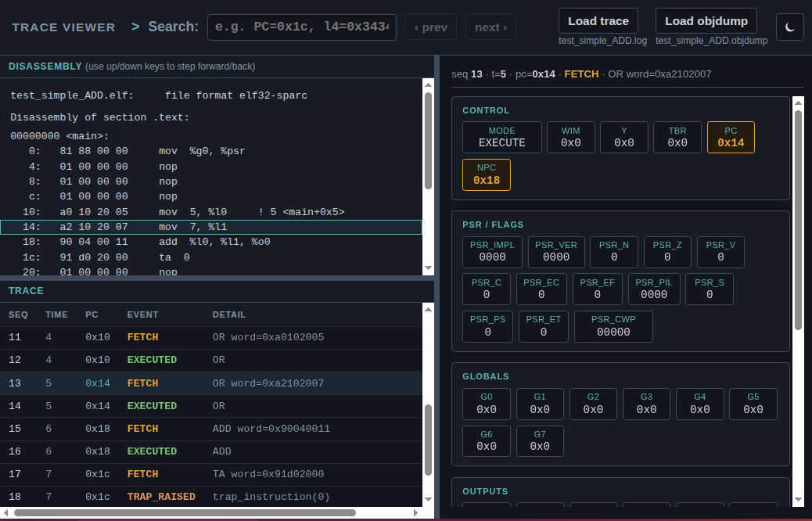

# Getting Started

This page builds the C++ model of the SPARC core, runs a first program
on it, and traces the run. It then introduces the Sitar timing model,
the other configurations, the validation suite, the compilation of new
programs, and debugging with gdb. The sections are meant to be read in
order. A section that needs an optional tool says so at its start, and
can be skipped if that tool is not installed.

The commands use `$SPARC_HOME`, the repository's folder, which is set
in step 2 of Installation.

---

## SPARC V8

SPARC V8 is the 32-bit RISC instruction set architecture that this
project models. It is standardized as ANSI/IEEE Std 1754-1994. See
[SPARC V8 Architecture](sparcv8_architecture.md) for what makes it
distinctive, and for a page-indexed guide to its authoritative manual,
which is bundled in this repository.

---

## How the models are organized

Each configuration of the system, such as the core alone or the core
with an MMU, has its own folder under `model/system_models/`. This page
starts with the simplest configuration, `core_only`, which consists of
the SPARC core and a main memory.

Each configuration folder holds two models. Each model is in its own
folder, with its own build script:

- **`cpp_model/`** holds the C++ model. It is fast and purely
  functional, with no notion of time.
- **`sitar_model/`** holds the Sitar model. It describes the same core,
  with cycle-level timing.

A build writes its executable into an `executable/` folder beside the
build script.

---

## A first program

The following small SPARC assembly program puts two numbers in
registers and adds them. It is in
`$SPARC_HOME/validation/test_simple_ADD/test_simple_ADD.s`:

```sparc
--8<-- "validation/test_simple_ADD/test_simple_ADD.s"
```

The simulator does not run assembly directly. It runs a memory image,
which is a `.hex` file holding the program's machine code. The memory
image of this program, `test_simple_ADD.hex`, is already in the same
folder, so the program can run without a cross-toolchain. The folder
also holds its disassembly, `test_simple_ADD.objdump`.

---

## Build the C++ model

The following commands go to the folder of the `core_only` C++ model
and build it:

```sh
cd $SPARC_HOME/model/system_models/core_only/cpp_model
./build.sh
```

The build produces `executable/sparc_sim_cpp_core_only`.

---

## Run the program

The following command, run in the same folder, runs the executable on
the program's memory image:

```sh
./executable/sparc_sim_cpp_core_only $SPARC_HOME/validation/test_simple_ADD/test_simple_ADD.hex
```

The executable loads the image, runs the program until it halts, and
prints the final state of the processor:

```
Total Main Memory size :0x10000000
Initializing memory from hex-dump file...
Last address written = 20
PROCESSOR STATE: ERROR
PSR.impl 0b0000
...
PC  0x1c
nPC 0x20
...
o0 0xc
...
Simulation halted after 9 cycles.
```

- **`o0 0xc`** shows that register `%o0` holds 12, the sum of 5 and 7.
- **`PROCESSOR STATE: ERROR`** is expected. Every program in this
  repository halts in this way. The last instruction of the program,
  `ta 0`, is a trap instruction executed with traps disabled. It puts
  the processor in its error mode, which stops it.
- **`9 cycles`** counts instructions, because the C++ model has no
  timing. Each "cycle" of this model is one instruction.

---

## Check the result automatically

Instead of reading the final state by eye, the executable can be given
the expected values to check. These values are written by hand in the
program's `.vprj` file, `test_simple_ADD.vprj`, under `RESULTS`:

```
RESULTS =
o0=0x0000000C
l0=0x00000005
l1=0x00000007
```

The executable does not read the `.vprj` file itself. It reads the same
checks from a plain `.expected` file, `test_simple_ADD.expected`, in the
same folder. The following command runs the check:

```sh
./executable/sparc_sim_cpp_core_only \
    $SPARC_HOME/validation/test_simple_ADD/test_simple_ADD.hex \
    $SPARC_HOME/validation/test_simple_ADD/test_simple_ADD.expected \
    --stats
```

The executable then prints PASS or FAIL for each expected value, and an
overall result. The `--stats` option adds the model's counters, which
include the numbers of instructions, loads, stores and traps:

```
Core statistics:
  Instructions fetched             = 8
  Loads                            = 0
  ... (more counters, all 0 for this program)

PASS: o0 = 0xc
PASS: l0 = 0x5
PASS: l1 = 0x7
OVERALL: PASS (3 checks)
```

The executable takes the following arguments:

```
sparc_sim_cpp_core_only <hex_file> [expected_results_file] [max_cycles] [--stats]
```

- **`hex_file`** is the memory image to run.
- **`expected_results_file`** is optional, and holds the values to
  check at the end. Without it, the executable prints the final state
  instead.
- **`max_cycles`** is optional, and stops the run after this many
  cycles, in case the program never halts. The default is 1,000,000.
- **`--stats`** is optional, and prints the model's counters at the
  end. It can appear anywhere among the arguments.

Each model's folder also has a script for this check,
`run_simple_test.sh`. It runs the same program against its expected
values, with `--stats`:

```sh
./run_simple_test.sh
```

For most programs in the repository, the `.expected` file is not part
of the clone. The validation runner, `run_tests.py`, writes it beside
each test from the test's `.vprj` file every time it runs that test.
`test_simple_ADD.expected` is committed as an exception, so that this
page works right after cloning. The following command runs the runner
once over the whole suite, which writes the `.expected` file of every
test. It takes about a minute:

```sh
$SPARC_HOME/validation/run_tests.py $SPARC_HOME/validation
```

[Run the validation suite](#run-the-validation-suite) below describes
the runner and its output.

---

## Trace a run

The model can also write a trace of the run, with one line per event
and the processor's state after each event. Tracing is off by default,
because it slows down long runs. The following command, run in the same
folder, builds the version of the model that writes the trace:

```sh
./build.sh --logging
```

This build produces a second executable,
`executable/sparc_sim_cpp_core_only_logging`, beside the first. The
following command runs it on the program:

```sh
./executable/sparc_sim_cpp_core_only_logging $SPARC_HOME/validation/test_simple_ADD/test_simple_ADD.hex
```

In addition to the same output as before, this executable writes the
trace to `test_simple_ADD.log` in the current folder. The trace file is
always named after the `.hex` file.

The trace is a plain text file with tab-separated columns, and can be
read in any editor. The repository also includes a trace viewer, which
steps through the run and shows how the processor's state changes.

### Try the trace viewer

**[The trace viewer, with this program's trace loaded](log_viewer/viewer.html?trace=test_simple_ADD.log)**

<p align="center">
  <a href="log_viewer/viewer.html?trace=test_simple_ADD.log">
    
  </a>
</p>

The viewer shows three panels side by side:

- The trace, from the `.log` file.
- The program's disassembly, from the `.objdump` file.
- The processor's registers after the selected event.

The viewer is used as follows:

- Clicking a line of the trace selects it. The viewer highlights the
  matching line of the disassembly, and shows the registers after that
  event. The `up` and `down` arrow keys step through the trace.
- Registers that changed at the selected event are highlighted.
- The search bar at the top finds a PC or a register value in the
  trace. The `Next` and `Prev` buttons step through the matches.

Each line of the trace holds a sequence number, the time, the PC, the
event type, a detail for the event, and the processor's state. This
program produces the following events:

- **`RESET`, then `TRAP_ENTER`**  
    These events begin every run. The processor starts by taking a
    reset trap into the program's first instruction.
- **`FETCH`, then `EXECUTED`, for each instruction**  
    The `FETCH` line shows the instruction about to run, with the
    registers as they were before it. The `EXECUTED` line that follows,
    with the same PC, shows the registers after it, with the changes
    highlighted. The registers `%l0`, `%l1` and `%o0` change at the
    `EXECUTED` lines of the two `mov` instructions and the `add`.
- **`TRAP_RAISED`, then `HALT`**  
    These events end the run. The `ta 0` instruction, executed with
    traps disabled, puts the processor in its error mode, and the run
    stops.

To view another trace, open `$SPARC_HOME/log_viewer/viewer.html` in a
browser. The **Load trace** button selects the `.log` file, and the
**Load objdump** button selects the `.objdump` file. The two files must
come from the same program, and from the same build of it. The viewer
matches each line of the trace to the disassembly by its PC, and does
not check that the two files belong together. With the disassembly of
another program, or of an older build, the highlighted instruction is
wrong or missing. A trace is named after its `.hex` file, and the
`.objdump` is written next to the `.hex`, so `my_add.log` belongs with
`my_add.objdump`. See [The log viewer](logging.md#the-log-viewer) for
more on the viewer.

!!! note "Memory isn't in the trace"
    The trace and the viewer show the registers, but not the contents
    of memory. Memory can be examined during a run with gdb. See
    [Debug with gdb](#debug-with-gdb) below.

---

## The Sitar timing model

*This section needs Sitar ([step 3 of Installation](installation.md#3-optional-install-sitar)).*

The Sitar model runs the same core, and adds the timing of each
instruction, memory access and interconnect. It is built and run in the
same way, in its own folder, with the following commands:

```sh
cd $SPARC_HOME/model/system_models/core_only/sitar_model
./build.sh
./executable/sparc_sim_sitar_core_only $SPARC_HOME/validation/test_simple_ADD/test_simple_ADD.hex
```

The output has the same form:

```
...
o0 0xc
...
Simulation halted after 8 cycles.
```

In this model, a cycle is a clock cycle of the modeled hardware. The
cycle count therefore depends on the timing settings, and is not the
number of instructions. The Sitar executable takes the same arguments
as the C++ executable, and its folder has its own `run_simple_test.sh`.

The command `./build.sh --logging` builds
`executable/sparc_sim_sitar_core_only_logging`. This executable writes
the same trace, `test_simple_ADD.log`. It also writes `sitar.log`,
which is Sitar's own lower-level log of the simulation.

---

## Build options

Both build scripts accept the following options, in any combination:

| Option | Builds | Purpose |
|---|---|---|
| (none) | `sparc_sim_<model>_<configuration>` | Normal runs, and the validation suite. |
| `--logging` | The same name, ending in `_logging` | Writing a trace of each run. |
| `--debug` | The same name, ending in `_debug` | Examining a run with gdb. It adds debug symbols, and keeps optimization. |
| `--debug-o0` | The same name, ending in `_debugo0` | Examining a run with gdb, without optimization, so that gdb can show every variable. |

Here `<model>` is `cpp` or `sitar`. Each option builds its own
executable, so the builds sit side by side in `executable/` and do not
replace each other.

---

## The other configurations

The other configurations add components to the core. Each one is a
folder under `model/system_models/`:

- **`core_mmu`** adds a Memory Management Unit (MMU), which translates
  each address that the program uses into a physical address.
- **`core_mmu_devices`** adds peripheral devices, which are a timer, a
  serial device and an interrupt controller.
- **`core_l1cache_mmu_devices`** adds instruction and data L1 caches.
- **`sparc_apara`** adds an APARA engine, a vector accelerator, beside
  the core.
- **`apara`** is the APARA engine on its own, with no SPARC core. It
  runs engine programs rather than SPARC programs. It is described in
  its own section, [The APARA Accelerator](apara/index.md).

Each configuration is built and run in the same way as `core_only`, in
its own folder, and its executables are named after it. For example,
the following commands build and run the C++ model of `core_mmu`:

```sh
cd $SPARC_HOME/model/system_models/core_mmu/cpp_model
./build.sh
./executable/sparc_sim_cpp_core_mmu $SPARC_HOME/validation/test_simple_ADD/test_simple_ADD.hex
```

---

## Run the validation suite

The repository has a large suite of test programs that check the
models. It contains several hundred assembly tests, each for one
instruction or a small family of instructions. It also contains
self-checking C programs, and tests of the MMU, the devices, the caches
and the APARA engine. Each test has its expected result. The suite is
in `$SPARC_HOME/validation/`, together with its runner, `run_tests.py`.

The runner uses the plain build of a model, made by `./build.sh` with
no options. That build must therefore exist for each model under test.
The runner is run from the repository's folder, and is given a folder
of tests. The following command runs a small folder first:

```sh
cd $SPARC_HOME
validation/run_tests.py validation/asm/misc
```

```
[PASS] validation/asm/misc/flush/FLUSH.vprj
...
[PASS] validation/asm/misc/stbar_unimp_nop_sethi/STBAR_UNIMP_NOP_SETHI.vprj

13/13 tests passed
```

The following command then runs the whole suite:

```sh
validation/run_tests.py validation
```

The runner runs every test that the configuration supports. It also
lists the folders it skips, which hold tests of components that the
configuration does not have:

```
skipped 4 test(s) under validation/C/caches: core_only has no caches
...
241/241 tests passed (158 skipped)
```

By default, the runner tests the C++ model of `core_only`. The
`--config` option selects another configuration, and the `--sitar`
option selects the Sitar model. The `-v` option shows every check,
rather than only the failures:

```sh
validation/run_tests.py validation --config core_mmu --sitar -v
```

The suite should be run after every change to a model, to check that
nothing broke. [Validation Suite](validation_suite.md) describes the
tests, the runner's options, and how to add a new test.

---

## Compile a new program

*This section needs the cross-toolchain ([step 4 of Installation](installation.md#4-optional-install-the-sparc-cross-toolchain)).*

A modified or new program must be compiled into a memory image before
it can run. The following commands create a separate working folder,
outside the repository, and copy the first program into it:

```sh
mkdir -p ~/sparc_programs
cd ~/sparc_programs
cp $SPARC_HOME/validation/test_simple_ADD/test_simple_ADD.s my_add.s
```

In `my_add.s`, change the line `mov 7, %l1` to `mov 30, %l1` with any
text editor. The following commands then assemble the program and run
it:

```sh
$SPARC_HOME/compiler/assemble.sh my_add.s
$SPARC_HOME/model/system_models/core_only/cpp_model/executable/sparc_sim_cpp_core_only my_add.hex
```

The script `assemble.sh` writes the memory image `my_add.hex` and the
disassembly `my_add.objdump`. It may warn that the sections `.data` and
`.rodata` do not exist. This warning is expected, because the program
has no data. At the end of the run, `%o0` holds 35:

```
o0 0x23
...
Simulation halted after 9 cycles.
```

A C program is compiled in the same way, with the command
`$SPARC_HOME/compiler/compile_c.sh my_program.c`. The next pages,
[Writing and Running Assembly Programs](writing_and_running_assembly_programs.md)
and [Writing and Running C Programs](writing_and_running_c_programs.md),
continue from here.

---

## Debug with gdb

*This section needs gdb ([step 5 of Installation](installation.md#5-optional-install-gdb)).*

A trace suits a short program, but the trace of a long program is too
large to read. With gdb, the model can instead be stopped at a chosen
point, and its registers and memory examined there. The models are
ordinary programs on the host machine, so the host's own `gdb` debugs
them directly.

A model runs under gdb with a command of the following general form:

```
gdb -x $SPARC_HOME/debug/sparc.gdb --args <executable> <hex file>
```

Here `sparc.gdb` is a set of shortcuts, provided by this project, for
viewing the model's state in SPARC terms. With them, registers and
breakpoints are named as in the SPARC program, without knowledge of the
variable names in the model's code. `<executable>` is a model built
with `./build.sh --debug`, and `<hex file>` is the program to run.

The following commands build the C++ model of `core_only` with debug
symbols, and start it in gdb on the first program:

```sh
cd $SPARC_HOME/model/system_models/core_only/cpp_model
./build.sh --debug
gdb -x $SPARC_HOME/debug/sparc.gdb --args \
    ./executable/sparc_sim_cpp_core_only_debug $SPARC_HOME/validation/test_simple_ADD/test_simple_ADD.hex
```

The following gdb session stops the model after the `add` instruction,
which is at PC `0x18` in the disassembly. It then prints three
registers, and lets the run continue:

```
(gdb) sparc-break pc=0x18
(gdb) run
(gdb) sparc-print-reg l0
l0 = 0x5 (5)
(gdb) sparc-print-reg l1
l1 = 0x7 (7)
(gdb) sparc-print-reg o0
o0 = 0xc (12)
(gdb) continue
```

[Examining Core State at Runtime Using GDB](examining_core_state_with_gdb.md)
describes further examples, and [GDB Command Reference](gdb_command_reference.md)
lists every command.

---

## Changing the models

The source of the models is in `$SPARC_HOME/model/`. The core and the
other components are written in plain C++ in `cpp_common_code/`. The
Sitar modules are in `sitar_component_models/`, and each configuration
is in `system_models/`. After a change, the model is rebuilt with
`./build.sh` in its folder, and the validation suite checks that
nothing broke. The Model section of this documentation describes how
the models are built.
