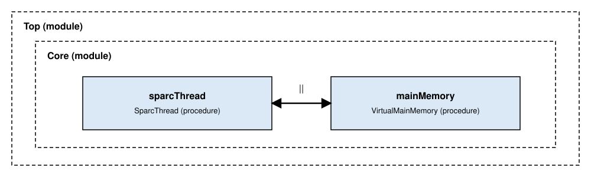
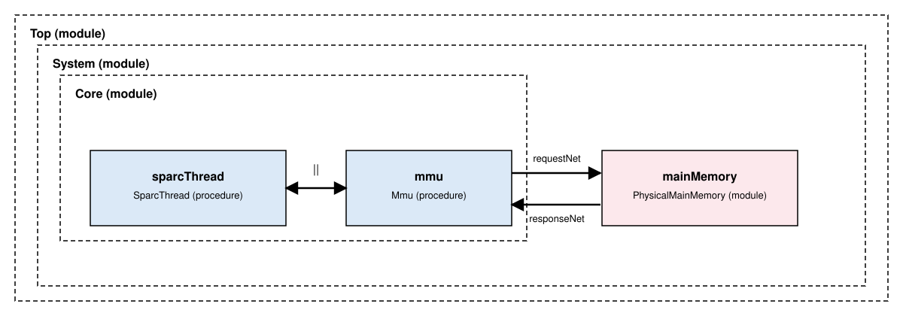
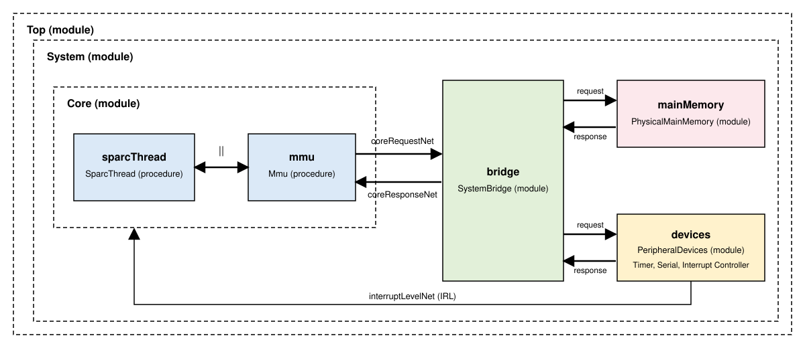
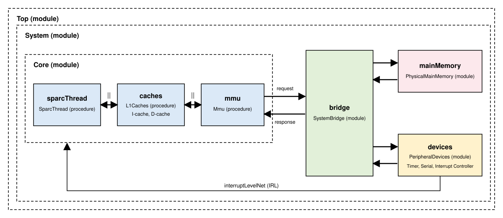

---
hide:
  - toc
---

# Model Configurations

This project provides several system configurations.

- **`core_only`**  
    Models only the SPARC core connected to main memory. Every
    processor-generated address (a virtual address) is used directly
    to index into main memory, with no translation.
- **`core_mmu`**  
    Adds a Memory Management Unit (MMU) between the core and main
    memory. Every processor-generated virtual address is translated to
    a physical address before it reaches main memory.
- **`core_mmu_devices`**  
    Adds a timer, an interrupt controller, and a serial device, as one
    shared set on the memory side of the MMU, reached by physical
    address like main memory.
- **`core_l1cache_mmu_devices`**  
    Adds split instruction and data L1 caches between the core and the
    MMU. VIVT, write-through, and compatible with the AJIT processor's
    own L1 caches.

For each configuration, there exist two implementations:

- **`cpp_model`**  
    A 0-delay functional model. A plain host C++ function-call chain
    through the model's components, with no notion of cycles or
    timing.
- **`sitar_model`**  
    A cycle-timed model. The same components, driven through Sitar
    with real per-opcode, interconnect, and memory timing.

The configurations and their path in the project (linked) are
summarized here:

| Configuration | Type | Description |
|---|---|---|
| core_only | [cpp (functional model)](https://github.com/sitar-sim/SparcV8_core/tree/main/model/system_models/core_only/cpp_model/) | The core plus main memory. No MMU, devices, or caches. |
| core_only | [sitar (timing model)](https://github.com/sitar-sim/SparcV8_core/tree/main/model/system_models/core_only/sitar_model/) | The core plus main memory. No MMU, devices, or caches. |
| core_mmu | [cpp (functional model)](https://github.com/sitar-sim/SparcV8_core/tree/main/model/system_models/core_mmu/cpp_model/) | Adds an MMU between the core and main memory. |
| core_mmu | [sitar (timing model)](https://github.com/sitar-sim/SparcV8_core/tree/main/model/system_models/core_mmu/sitar_model/) | Adds an MMU between the core and main memory. |
| core_mmu_devices | [cpp (functional model)](https://github.com/sitar-sim/SparcV8_core/tree/main/model/system_models/core_mmu_devices/cpp_model/) | Adds the peripheral devices below the MMU. |
| core_mmu_devices | [sitar (timing model)](https://github.com/sitar-sim/SparcV8_core/tree/main/model/system_models/core_mmu_devices/sitar_model/) | Adds the peripheral devices below the MMU. |
| core_l1cache_mmu_devices | [cpp (functional model)](https://github.com/sitar-sim/SparcV8_core/tree/main/model/system_models/core_l1cache_mmu_devices/cpp_model/) | Adds split L1 caches between the core and the MMU. |
| core_l1cache_mmu_devices | [sitar (timing model)](https://github.com/sitar-sim/SparcV8_core/tree/main/model/system_models/core_l1cache_mmu_devices/sitar_model/) | Adds split L1 caches between the core and the MMU. |
| apara | [cpp (functional model)](https://github.com/sitar-sim/SparcV8_core/tree/main/model/system_models/apara/cpp_model/) | One APARA engine on its own, no SPARC core (Ref [The APARA Engine](apara/index.md)). |
| apara | [sitar (timing model)](https://github.com/sitar-sim/SparcV8_core/tree/main/model/system_models/apara/sitar_model/) | One APARA engine on its own, with its pipeline's timing. |
| sparc_apara | [cpp (functional model)](https://github.com/sitar-sim/SparcV8_core/tree/main/model/system_models/sparc_apara/cpp_model/) | core_l1cache_mmu_devices plus one APARA engine (Ref [The Engine in a System](apara/system.md)). |
| sparc_apara | [sitar (timing model)](https://github.com/sitar-sim/SparcV8_core/tree/main/model/system_models/sparc_apara/sitar_model/) | core_l1cache_mmu_devices plus one APARA engine, on a two-master bus. |

For each configuration, both the cpp and sitar models include the same
components: `core_mmu`'s MMU, for example, is present in both its
`cpp_model` and its `sitar_model`, just reached with 0 added delay in
the former and real Sitar timing in the latter.

See [Model Components](model_components.md) for the list of all
components, such as the SPARC Core, the MMU, and devices, that are
included in this project.

---

## Sitar Model Structure

For specifically the Sitar models, which have a notion of structure and
timing, this section describes the structure and component
interconnections for each configuration, as well as the code
structure.

### Configuration: core_only

#### Structure diagram

No net crossing anywhere. The core talks directly to memory over a
procedure handshake, so zero delay communication is possible between
the core and memory procedures. The "--||--" symbol indicates direct
communication between the two procedures using a handshake and shared
variables.

#### Model description

This shows component instance ownership: which design unit
instantiates which, and how many instances.

<pre>
<a href="https://github.com/sitar-sim/SparcV8_core/blob/main/model/system_models/core_only/sitar_model/src/Top.sitar">Top</a>
 |
 +-- <a href="https://github.com/sitar-sim/SparcV8_core/blob/main/model/system_models/core_only/sitar_model/src/Core.sitar">Core</a> (module)
      |
      +-- sparcThread : <a href="https://github.com/sitar-sim/SparcV8_core/blob/main/model/sitar_component_models/SparcThread.sitar">SparcThread</a> (procedure)
      |    |
      |    +-- 5x <a href="https://github.com/sitar-sim/SparcV8_core/blob/main/model/sitar_component_models/VirtualMainMemoryInterface.sitar">VirtualMainMemoryInterface</a> (procedure)
      |
      +-- mainMemory : <a href="https://github.com/sitar-sim/SparcV8_core/blob/main/model/sitar_component_models/VirtualMainMemory.sitar">VirtualMainMemory</a> (procedure)
</pre>

---

### Configuration: core_mmu

#### Structure diagram

The core talks to the MMU over the same procedure handshake `core_only`
uses. The MMU talks to physical memory over two nets, since
`PhysicalMainMemory` is a module, not a procedure. Crossing a net costs
Sitar's own unavoidable minimum one cycle each way, so even at every
knob's default this configuration cannot reach a fully 0-delay run the
way `core_only` can.

#### Model description

This shows component instance ownership: which design unit
instantiates which, and how many instances.

<pre>
<a href="https://github.com/sitar-sim/SparcV8_core/blob/main/model/system_models/core_mmu/sitar_model/src/Top.sitar">Top</a>
 |
 +-- <a href="https://github.com/sitar-sim/SparcV8_core/blob/main/model/system_models/core_mmu/sitar_model/src/System.sitar">System</a> (module)
      |
      +-- core : <a href="https://github.com/sitar-sim/SparcV8_core/blob/main/model/system_models/core_mmu/sitar_model/src/Core.sitar">Core</a> (module)
      |    |
      |    +-- sparcThread : <a href="https://github.com/sitar-sim/SparcV8_core/blob/main/model/sitar_component_models/SparcThread.sitar">SparcThread</a> (procedure)
      |    |    |
      |    |    +-- 5x <a href="https://github.com/sitar-sim/SparcV8_core/blob/main/model/sitar_component_models/VirtualMainMemoryInterface.sitar">VirtualMainMemoryInterface</a> (procedure)
      |    |
      |    +-- mmu : <a href="https://github.com/sitar-sim/SparcV8_core/blob/main/model/sitar_component_models/Mmu.sitar">Mmu</a> (procedure)
      |         |
      |         +-- 2x <a href="https://github.com/sitar-sim/SparcV8_core/blob/main/model/sitar_component_models/PhysicalMainMemoryInterface.sitar">PhysicalMainMemoryInterface</a> (procedure)
      |              |
      |              +-- <a href="https://github.com/sitar-sim/SparcV8_core/blob/main/model/sitar_component_models/PullAToken.sitar">PullAToken</a> / <a href="https://github.com/sitar-sim/SparcV8_core/blob/main/model/sitar_component_models/PushAToken.sitar">PushAToken</a> (procedure)
      |
      +-- mainMemory : <a href="https://github.com/sitar-sim/SparcV8_core/blob/main/model/sitar_component_models/PhysicalMainMemory.sitar">PhysicalMainMemory</a> (module)
           |
           +-- <a href="https://github.com/sitar-sim/SparcV8_core/blob/main/model/sitar_component_models/PullAToken.sitar">PullAToken</a> / <a href="https://github.com/sitar-sim/SparcV8_core/blob/main/model/sitar_component_models/PushAToken.sitar">PushAToken</a> (procedure)

core.requestOut  --requestNet-->  mainMemory.requestIn
core.responseIn  <-responseNet--  mainMemory.responseOut
</pre>

---

### Configuration: core_mmu_devices

#### Structure diagram

The core and its MMU are unchanged from `core_mmu`. Below the MMU sits
a bridge, which reads the physical address of each access and sends it
either to main memory or to the peripheral devices (Timer, Serial,
Interrupt Controller). The devices are one shared set on the memory
side, not part of the core, the same way the AJIT processor organizes
them. That is what lets several cores share them later.

Every arrow between modules is a net, and every net crossing costs at
least one cycle. A memory access crosses four nets here (core to
bridge to memory, and back), two more than in `core_mmu`. The
Interrupt Controller sends its interrupt level to the core over its own
net, as a level: a token arrives only when the level changes, and the
core polls that net once per cycle. An interrupt therefore reaches the
core one cycle after the Interrupt Controller raises it.

The devices' behavior is the same C++ class in both models
(`PeripheralDevicesCore`). The cpp_model ticks it once after every core
cycle. The sitar_model's `PeripheralDevices` module ticks it once per
simulated cycle. See [Peripheral Devices](peripheral_devices.md) for
what the devices do.

#### Model description

<pre>
<a href="https://github.com/sitar-sim/SparcV8_core/blob/main/model/system_models/core_mmu_devices/sitar_model/src/Top.sitar">Top</a>
 |
 +-- <a href="https://github.com/sitar-sim/SparcV8_core/blob/main/model/system_models/core_mmu_devices/sitar_model/src/System.sitar">System</a> (module)
      |
      +-- core : <a href="https://github.com/sitar-sim/SparcV8_core/blob/main/model/system_models/core_mmu_devices/sitar_model/src/Core.sitar">Core</a> (module)
      |    |
      |    +-- sparcThread : <a href="https://github.com/sitar-sim/SparcV8_core/blob/main/model/sitar_component_models/SparcThread.sitar">SparcThread</a> (procedure)
      |    |
      |    +-- mmu : <a href="https://github.com/sitar-sim/SparcV8_core/blob/main/model/sitar_component_models/Mmu.sitar">Mmu</a> (procedure)
      |
      +-- bridge : <a href="https://github.com/sitar-sim/SparcV8_core/blob/main/model/sitar_component_models/SystemBridge.sitar">SystemBridge</a> (module)
      |
      +-- mainMemory : <a href="https://github.com/sitar-sim/SparcV8_core/blob/main/model/sitar_component_models/PhysicalMainMemory.sitar">PhysicalMainMemory</a> (module)
      |
      +-- devices : <a href="https://github.com/sitar-sim/SparcV8_core/blob/main/model/sitar_component_models/PeripheralDevices.sitar">PeripheralDevices</a> (module)

core.requestOut          --coreRequestNet-->     bridge.coreRequestIn
core.responseIn          <-coreResponseNet--     bridge.coreResponseOut
bridge.memoryRequestOut  --memoryRequestNet-->   mainMemory.requestIn
bridge.memoryResponseIn  <-memoryResponseNet--   mainMemory.responseOut
bridge.devicesRequestOut --devicesRequestNet-->  devices.requestIn
bridge.devicesResponseIn <-devicesResponseNet--  devices.responseOut
devices.interruptLevelOut --interruptLevelNet--> core.interruptLevelIn
</pre>

---

### Configuration: core_l1cache_mmu_devices

#### Structure diagram

The same system as `core_mmu_devices`, with one more procedure inside
`Core`: the split L1 caches, between `sparcThread` and `mmu`. All three
are procedures of the one `Core` module, so a cache hit completes with
no net crossing and no added delay (unless a hit-latency knob is set).
A miss reads the whole 64-byte line through the MMU, which costs the
MMU's translation plus eight doubleword transactions through the
bridge. See [Model Components](model_components.md#caches) for what the
caches do.

Nothing is cached while the MMU is disabled, unless the MMU Control
Register's "always cacheable" bit is set (as in AJIT). A program can set
it itself, or the simulator can, with `--always-cacheable`.

#### Model description

<pre>
<a href="https://github.com/sitar-sim/SparcV8_core/blob/main/model/system_models/core_l1cache_mmu_devices/sitar_model/src/Top.sitar">Top</a>
 |
 +-- <a href="https://github.com/sitar-sim/SparcV8_core/blob/main/model/system_models/core_l1cache_mmu_devices/sitar_model/src/System.sitar">System</a> (module)
      |
      +-- core : <a href="https://github.com/sitar-sim/SparcV8_core/blob/main/model/system_models/core_l1cache_mmu_devices/sitar_model/src/Core.sitar">Core</a> (module)
      |    |
      |    +-- sparcThread : <a href="https://github.com/sitar-sim/SparcV8_core/blob/main/model/sitar_component_models/SparcThread.sitar">SparcThread</a> (procedure)
      |    |
      |    +-- caches : <a href="https://github.com/sitar-sim/SparcV8_core/blob/main/model/sitar_component_models/L1Caches.sitar">L1Caches</a> (procedure)
      |    |
      |    +-- mmu : <a href="https://github.com/sitar-sim/SparcV8_core/blob/main/model/sitar_component_models/Mmu.sitar">Mmu</a> (procedure)
      |
      +-- bridge : <a href="https://github.com/sitar-sim/SparcV8_core/blob/main/model/sitar_component_models/SystemBridge.sitar">SystemBridge</a> (module)
      |
      +-- mainMemory : <a href="https://github.com/sitar-sim/SparcV8_core/blob/main/model/sitar_component_models/PhysicalMainMemory.sitar">PhysicalMainMemory</a> (module)
      |
      +-- devices : <a href="https://github.com/sitar-sim/SparcV8_core/blob/main/model/sitar_component_models/PeripheralDevices.sitar">PeripheralDevices</a> (module)
</pre>

The nets are the same seven as in `core_mmu_devices`.

---

### Configuration: apara

One APARA engine, standalone: its program and data are placed straight
into its memories before the run (Ref [Writing and Running APARA
Programs](apara/running.md)). The engine's pipeline is one module per
stage, joined by nets with the hardware's channel depths; see
[APARA Timing Model](apara/timing_model.md) for what each does.

#### Model description

<pre>
<a href="https://github.com/sitar-sim/SparcV8_core/blob/main/model/system_models/apara/sitar_model/src/Top.sitar">Top</a>
 |
 +-- engine : <a href="https://github.com/sitar-sim/SparcV8_core/blob/main/model/sitar_component_models/AparaEngine.sitar">AparaEngine</a> (module)
      |
      +-- fetch     : <a href="https://github.com/sitar-sim/SparcV8_core/blob/main/model/sitar_component_models/AparaFetch.sitar">AparaFetch</a> (module)
      +-- decode    : <a href="https://github.com/sitar-sim/SparcV8_core/blob/main/model/sitar_component_models/AparaDecode.sitar">AparaDecode</a> (module)
      +-- regfile   : <a href="https://github.com/sitar-sim/SparcV8_core/blob/main/model/sitar_component_models/AparaRegfile.sitar">AparaRegfile</a> (module)
      +-- exec      : <a href="https://github.com/sitar-sim/SparcV8_core/blob/main/model/sitar_component_models/AparaExec.sitar">AparaExec</a> (module)
      +-- writeback : <a href="https://github.com/sitar-sim/SparcV8_core/blob/main/model/sitar_component_models/AparaWriteback.sitar">AparaWriteback</a> (module)
</pre>

| Net | Capacity | From, to |
|---|---|---|
| `fetchToDecode` | 2 | FETCH to DECODE |
| `decodeToRegfile[0..3]` | 2 | DECODE to REGFILE, one per thread |
| `regfileToExec` | 2 | REGFILE to EXEC |
| `execToRegfile` | 1 | EXEC's results back to REGFILE |
| `regfileToWriteback` | 2 | REGFILE to WRITEBACK |
| `correctionNet`, `haltNet` | 1 | WRITEBACK to FETCH |

---

### Configuration: sparc_apara

`core_l1cache_mmu_devices` plus one APARA engine. The engine's pipeline
and its host side (control and DMA units) are modules beside the core,
and the bus takes requests from both the core and the engine (Ref [The
Engine in a System](apara/system.md)).

#### Model description

<pre>
<a href="https://github.com/sitar-sim/SparcV8_core/blob/main/model/system_models/sparc_apara/sitar_model/src/Top.sitar">Top</a>
 |
 +-- <a href="https://github.com/sitar-sim/SparcV8_core/blob/main/model/system_models/sparc_apara/sitar_model/src/System.sitar">System</a> (module)
      |
      +-- core : <a href="https://github.com/sitar-sim/SparcV8_core/blob/main/model/system_models/sparc_apara/sitar_model/src/Core.sitar">Core</a> (module: sparcThread, caches, mmu)
      +-- interconnect : <a href="https://github.com/sitar-sim/SparcV8_core/blob/main/model/sitar_component_models/SystemInterconnect.sitar">SystemInterconnect</a>&lt;2&gt; (module)
      +-- mainMemory : <a href="https://github.com/sitar-sim/SparcV8_core/blob/main/model/sitar_component_models/PhysicalMainMemory.sitar">PhysicalMainMemory</a> (module)
      +-- devices : <a href="https://github.com/sitar-sim/SparcV8_core/blob/main/model/sitar_component_models/PeripheralDevices.sitar">PeripheralDevices</a> (module)
      +-- engine : <a href="https://github.com/sitar-sim/SparcV8_core/blob/main/model/sitar_component_models/AparaEngine.sitar">AparaEngine</a> (module: fetch, decode, regfile, exec, writeback)
      +-- host : <a href="https://github.com/sitar-sim/SparcV8_core/blob/main/model/sitar_component_models/AparaHost.sitar">AparaHost</a> (module)
</pre>
