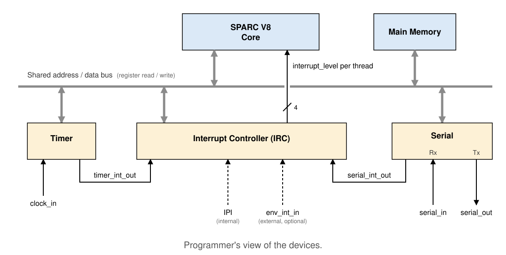

---
hide:
  - toc
---

# Peripheral Devices

## Overview

The purpose of the peripheral devices modeled here is to include a bare
minimum set of devices that make the model realistic, and sufficient
to port a basic operating system on top of it.

- **[Timer](peripheral_devices_timer.md)**  
    A one-shot timer, used for generating periodic interrupts, the
    kind an OS uses for context switching.
- **[Interrupt Controller](peripheral_devices_interrupt_controller.md)**  
    Routes hardware interrupts to the hardware threads of every core,
    and lets threads interrupt each other (inter-processor interrupts).
- **[Serial Device](peripheral_devices_serial_device.md)**  
    A single device for I/O.

The register formats, addresses, and behavior documented here are
credited to the [AJIT processor
documentation](https://github.com/adhuliya/ajit-toolchain/blob/marshal/docs/processor/ajit_processor_description.pdf),
Chapter 8, "Basic peripherals available for AJIT systems". The device
models in this project are designed to be compatible with it, except
for the deviations listed at the end of this page.

---

## Connection diagram

A programmer's view of how the devices connect.

There is a single shared set of devices in the system, on the memory
side of the MMU. Every device has registers that are read and written
over the same physical bus the core uses for main memory, by physical
address. In the Sitar model a bridge routes each access to main memory
or to the devices (see [Model Configurations](model_configurations.md)).
Each device also has its own individual signal pins, unrelated to the
bus:

- **Timer**: a `clock_in` input, and a `timer_int_out` output to the
  Interrupt Controller.
- **Serial Device**: `serial_in`/`serial_out` pins, and a
  `serial_int_out` output to the Interrupt Controller.
- **Interrupt Controller**: `timer_int_out`/`serial_int_out` inputs,
  an external interrupt input (`env_int_in`, for an external source
  such as an accelerator: in `sparc_apara`, the APARA engine), and one
  `interrupt_level` output per hardware thread. Inter-processor
  interrupts are generated inside it, from its own IPI registers.

---

## Device address map

Reach the registers with the MMU bypass ASI (`0x20`, see Appendix I of the SPARC V8 manual), or with an
ordinary translated access if the page is identity mapped.

| Device : Register | Address | Access type | Instruction example |
|---|---|---|---|
| Interrupt Controller : Control, thread (core c, thread t) | `0xFFFF3000 + 4*(2c+t)` | word (32-bit) | `sta %rs, [%rd] 0x20` |
| Interrupt Controller : IPI registers | `0xFFFF3080` to `0xFFFF30CB` | word (32-bit) | `sta %rs, [%rd] 0x20` |
| Timer : Control | `0xFFFF3100` | word (32-bit) | `sta %rs, [%rd] 0x20` |
| Serial : Control | `0xFFFF3200` | word (32-bit) | `sta %rs, [%rd] 0x20` |
| Serial : Tx | `0xFFFF3204` | byte (8-bit) | `stba %rs, [%rd] 0x20` |
| Serial : Rx | `0xFFFF3208` | byte (8-bit) | `lduba [%rd] 0x20, %rs` |
| Serial : Baud limit / baud control | `0xFFFF320c` | word (32-bit) | `sta %rs, [%rd] 0x20` |
| Serial : Baud frequency | `0xFFFF3210` | word (32-bit) | `sta %rs, [%rd] 0x20` |

`%rd` holds the register's address, loaded with `set` beforehand. C
programs can use the routines in `compiler/include/`
instead (see [C Programs](writing_and_running_c_programs.md)).

An access to an address in the device window (`0xFFFF0000` and up)
that no device decodes reads as 0 and ignores writes, with a warning
from the simulator.

---

## Interrupt levels

| Source | IRL | Priority |
|---|---|---|
| Timer | 10 | Highest |
| IPI (inter-processor interrupt) | 11 | |
| Serial | 12 | |
| Env (external: the APARA engine in `sparc_apara`) | 14 | Lowest |

For each hardware thread, the Interrupt Controller priority-encodes
the active sources that thread's mask enables: the lowest IRL number
among them wins. See the Interrupt Controller page for the details.

---

## Deviations from the AJIT Processor

Differences from AJIT's own device models (in its multi-core C model,
`devices/src/` in the ajit-toolchain repository), each small and
deliberate:

- **Timer clock.** AJIT's timer counts wall-clock time on the host.
  Here it counts model ticks, one per core cycle by default (a
  configurable divider). In hardware the timer may run off its own
  clock, so timer counts are not hardware time.
- **IPI register decode.** AJIT decodes the IPI word index from the low
  6 address bits only, so its last three IPI words alias onto the first
  three (the lock word lands on thread 0's message). Here all 19 words
  are separate.
- **Serial baud registers and `UART_reset`.** Present here (from the
  AJIT processor description), absent from AJIT's C model. The baud
  values are stored and read back but do not set the model's transmit
  timing, which is its own knob.
- **Serial receive disable.** Writing `Rx_en=0` disables the receiver
  from any state here, as the AJIT processor description says. AJIT's C
  model only does so while holding a received byte.
- **Serial transmit disable.** Writing `Tx_en=0` while a byte is still
  being transmitted finishes sending it first, so no program output is
  lost.
- **Unmapped device addresses** read as 0 and ignore writes, with a
  warning, the same as AJIT's bridge does for any unmapped address.
- **Device map and C routines.** The address map above is AJIT's
  default device map, so software written for AJIT finds every device
  where it expects it. The headers in `compiler/include/` keep the file
  names, function names, and signatures of AJIT's bare-metal access
  routines (`tools/ajit_access_routines_mt/` in the ajit-toolchain
  repository), so code written for AJIT compiles here unchanged; the
  implementations are this project's own.
- **Serial register addresses.** The map above is the one in the
  multi-thread access routines
  (`tools/ajit_access_routines_mt/include/default_device_addresses.h`,
  ajit-toolchain repository, `marshal` branch). Older AJIT sources (the
  single-thread access routines, AJIT's C models, and the processor
  description's Serial chapter) put Tx at `0xFFFF3210` and Rx at
  `0xFFFF3220`.
