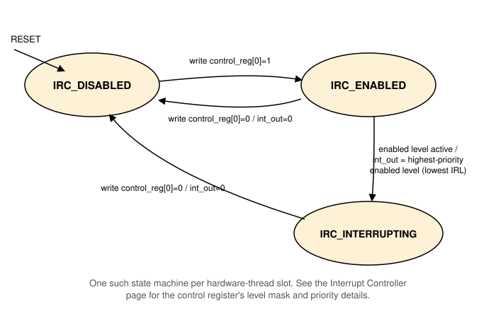

# Interrupt Controller

A single, shared Interrupt Controller (IRC) routes the system's
interrupt sources to the hardware threads of every core. It has two
parts:

- one **slot** per hardware thread, each with its own control
  register, its own state, and its own `interrupt_level` output to that
  thread;
- an **inter-processor interrupt (IPI)** block, which lets any thread
  interrupt any other (or itself).

All its registers are accessed with word loads and stores. See
[Peripheral Devices](peripheral_devices.md) for the connection diagram
and the full address map.

## Interrupt sources

| Source | IRL | Reaches |
|---|---|---|
| [Timer](peripheral_devices_timer.md) | 10 | every slot (each slot's mask decides) |
| IPI | 11 | the destination slot only |
| [Serial Device](peripheral_devices_serial_device.md) | 12 | every slot (each slot's mask decides) |
| External (`env_int_in`) | 14 | every slot (each slot's mask decides) |

The external input is for a source outside this device set, such as an
accelerator. In `sparc_apara` the APARA engine drives it, to signal that
an engine thread or a DMA transfer has finished (see [The Engine in a
System](apara/system.md#interrupts)). In the other configurations
nothing drives it, and it stays 0.

## Slots

There are 8 slots, enough for 4 cores with 2 hardware threads each. The
slot for core `c`, thread `t` is number `2c + t`, and its control
register is at `0xFFFF3000 + 4*(2c + t)`. A program finds its own core
and thread with `rd %asr29`, which reads `(core << 8) | thread` (in C,
`ajit_get_core_and_thread_id()`). The single-core configurations here
are core 0, thread 0, so they use slot 0 at `0xFFFF3000`.

### Control register

| Bits | Field | Access | Description |
|---|---|---|---|
| `[0]` | Enable | read/write | 1 enables this slot. Writing 0 disables it and drops its `interrupt_level`. |
| `[15:1]` | Level mask | read/write | Bit `i` set: interrupt level `i` is delivered to this thread. |
| `[30:16]` | Active sources | read only | Bit `15+i` is 1 while a source at level `i` is active, whether or not it is masked. |
| `[31]` | Interrupting | read only | 1 while the slot is in `IRC_INTERRUPTING`. |

The mask bit positions equal each source's level, so masking a source
is a bitwise AND. Writes to the read-only bits are ignored. The active
sources field lets software see a source that is pending but masked,
and is readable even while the slot is disabled.

### Priority

When more than one enabled level is active at once, the lowest level
number wins: **Timer (10) > IPI (11) > Serial (12) > External (14)**.

### Behavior

Each slot runs its own state machine:

- **`IRC_DISABLED`**  
    The reset state. `interrupt_level` is 0. A write that sets the
    enable bit moves to `IRC_ENABLED`.
- **`IRC_ENABLED`**  
    Watches the sources. As soon as any level enabled in the mask is
    active, `interrupt_level` is set to that level (the
    highest-priority one, if more than one), and the slot moves to
    `IRC_INTERRUPTING`.
- **`IRC_INTERRUPTING`**  
    `interrupt_level` stays asserted, even if the source goes away,
    until software clears the enable bit.

A write that clears the enable bit, from any state, immediately drops
`interrupt_level` and moves to `IRC_DISABLED`. A write that sets the
enable bit while already enabled or interrupting only updates the mask.

## Handling an interrupt

The usual sequence, which the routines in `compiler/include/ajit_mt_irc.h`
implement (see [C Programs](writing_and_running_c_programs.md)):

1. The interrupt trap for level `L` is taken.
2. The handler disables its own slot, which drops `interrupt_level`.
3. It clears the source (for example, disables the timer, or reads the
   Serial device's Rx register).
4. It enables its slot again. If another enabled source is still
   active, the slot delivers it next.

## Inter-processor interrupts (IPI)

The IPI block is 19 words at `0xFFFF3080`:

| Offset | Register | Description |
|---|---|---|
| `0x00` | IPI mask | Bit `s`: IPIs to slot `s` are enabled. |
| `0x04` | IPI value | Bit `s`: an IPI is pending for slot `s`. |
| `0x08` to `0x47` | Messages | 8 bytes per destination slot (slot `s` at `0x08 + 8s`), for software. |
| `0x48` | Lock | A word for software to use as a lock. |

Slot `s` sees an IPI (level 11) while bit `s` is set in both the mask
and the value. To interrupt another thread, a thread writes a message
for it, then sets its bit in the value register (and in the mask, if
not already set). The interrupted thread reads its message and clears
its value bit. Locking around these steps, with the lock word or
otherwise, is up to software. The routines in
`compiler/include/ajit_ipi.h` (`__ajit_set_ipi_interrupt__()` and
friends) do the register work.
