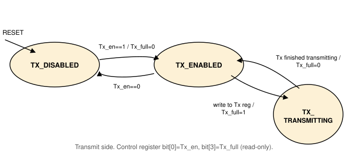
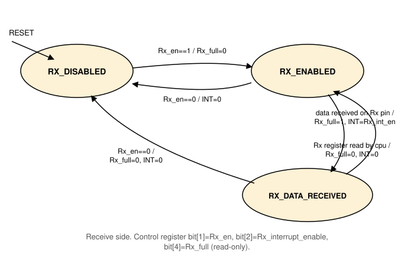

# Serial Device

A memory-mapped serial device (UART) that exchanges bytes between the
core and an external I/O device. It has `serial_in`/`serial_out`
pins, a `serial_int_out` output pin to the [Interrupt
Controller](peripheral_devices_interrupt_controller.md) (IRL 12), and
communicates with the core over the shared address/data bus through
its own set of registers. See [Peripheral
Devices](peripheral_devices.md) for the connection diagram and the
full address map.

A single instance is modeled. A self-tuning variant, which
auto-detects baud rate from an initial calibration byte, is not used
here.

## Registers

| Register | Width | Access |
|---|---|---|
| Control | 32-bit | word (`ld`/`st`) |
| Tx | 8-bit | byte store (`stb`), write only |
| Rx | 8-bit | byte load (`ldub`), read only |
| Baud limit / baud control | 32-bit | word |
| Baud frequency | 32-bit | word |

See [Peripheral Devices](peripheral_devices.md#device-address-map) for
the address of each register.

Each register has its own address. Tx and Rx are byte registers: a
byte store to Tx's address sends that byte, and a byte load from Rx's
address returns the received byte.

### Control register bit-fields

| Bit | Field | Description |
|---|---|---|
| `[0]` | `Tx_en` | Transmit enable. |
| `[1]` | `Rx_en` | Receive enable. |
| `[2]` | `Rx_interrupt_enable` | If set, receiving a byte raises an interrupt. |
| `[3]` | `Tx_full` (read-only) | Set once the CPU writes Tx, cleared once it is transmitted. |
| `[4]` | `Rx_full` (read-only) | Set once a byte is received into Rx, cleared once the CPU reads it. |
| `[5]` | `UART_reset` | Writing 1 resets both state machines to their reset state (a byte still being transmitted is dropped). Always reads 0. Present only in the newest of the AJIT references consulted, see the deviations list on the [Peripheral Devices](peripheral_devices.md#deviations-from-the-ajit-processor) page. |

## Baud rate

The baud-limit and baud-frequency registers are computed from a
desired baud rate and clock frequency, from the GCD of 16 times the
baud rate and the clock frequency:

```
gcd            = GCD(16 x baud_rate, clock_frequency)
baud_frequency = (16 x baud_rate) / gcd
baud_limit     = (clock_frequency / gcd) - baud_frequency
```

The model stores both registers and reads them back, but they do not
set its transmit timing. How long a byte takes to transmit is the
model's own `txTicksPerByte` setting (default 1 cycle, see [Model
Configuration Settings](model_configuration_settings.md)).

## Behavior

The device is modeled by two independent state machines, transmit and
receive, sharing the one control register above.

### Transmit

- **`TX_DISABLED`**  
    The reset state. A write of `Tx_en=1` clears `Tx_full` and moves
    to `TX_ENABLED`.
- **`TX_ENABLED`**  
    Waits for a Tx register write. On one, `Tx_full` is set and the
    device moves to `TX_TRANSMITTING`.
- **`TX_TRANSMITTING`**  
    Once the byte finishes transmitting, `Tx_full` is cleared and the
    device returns to `TX_ENABLED`. A Tx write while still transmitting
    is dropped.

A write of `Tx_en=0` from any state returns to `TX_DISABLED`. If a byte
is still being transmitted, it is sent first.

To send a byte: enable the transmitter, write the byte to the Tx
register, then poll `Tx_full` until it clears before writing the next
one (or disable the transmitter).



### Receive

- **`RX_DISABLED`**  
    The reset state. A write of `Rx_en=1` clears `Rx_full` and moves
    to `RX_ENABLED`.
- **`RX_ENABLED`**  
    Waits for a byte on the `serial_in` pin. On one, `Rx_full` is set,
    an interrupt is raised if `Rx_interrupt_enable` is set, and the
    device moves to `RX_DATA_RECEIVED`.
- **`RX_DATA_RECEIVED`**  
    Once the CPU reads the Rx register, `Rx_full` and the interrupt
    are cleared and the device returns to `RX_ENABLED`.

A write of `Rx_en=0` from any state clears `Rx_full` and the
interrupt, and returns to `RX_DISABLED`. While the receiver is disabled
or still holds an unread byte, incoming bytes wait, they are not lost.

The receiver supports two usage modes, selected by `Rx_interrupt_enable`:

- **Polling mode** (`Rx_interrupt_enable=0`): enable the receiver,
  poll `Rx_full` until it sets, then read the Rx register (and
  disable the receiver, or leave it enabled for the next byte).
- **Interrupt mode** (`Rx_interrupt_enable=1`): enable the receiver,
  wait for the interrupt, then read the Rx register (and disable the
  receiver, or leave it enabled for the next byte).



## Where the bytes go in the simulator

The serial device exists so a program can show output and take input.
By default every transmitted byte is written straight to the
simulator's own standard output, as the program sends it. Received
bytes come from an input file. Every configuration with devices accepts:

| Option | Effect |
|---|---|
| `--serial-in <file>` | Bytes received on `serial_in` come from this file, in order. |
| `--serial-out <file>` | Transmitted bytes go to this file instead of standard output. |
| `--serial-pty` | A pseudo-terminal carries both directions. The simulator prints its device name, attach any terminal program to it. |

Without `--serial-in`, a file next to the program's `.hex` with the
same name and the extension `.serial_in` is used, if it exists. That is
how a validation test carries its own input.

